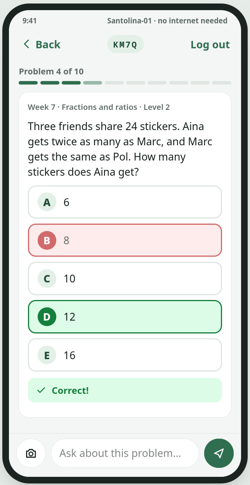
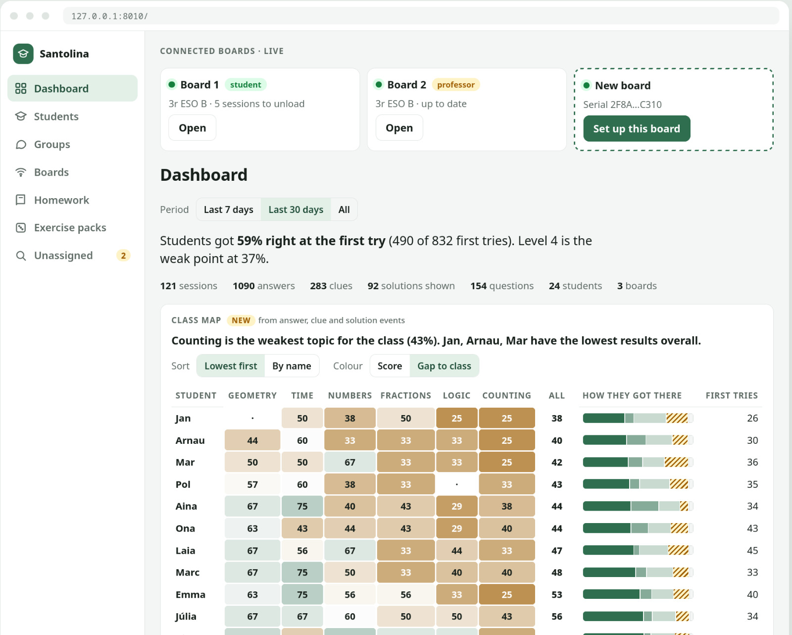
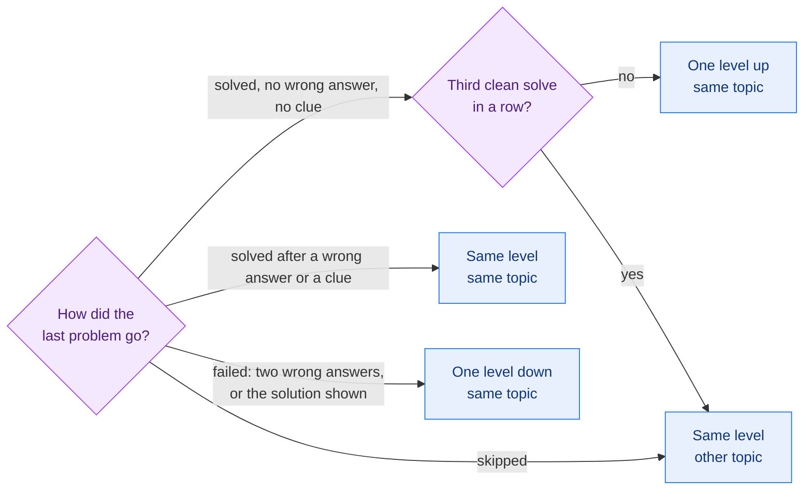
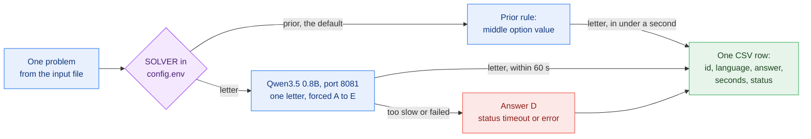
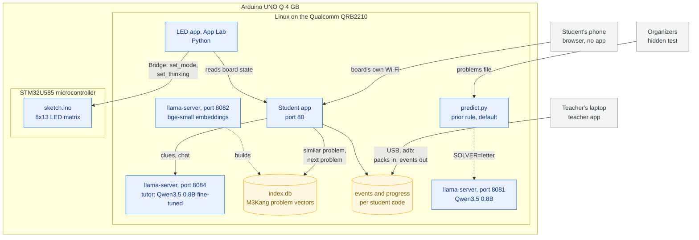
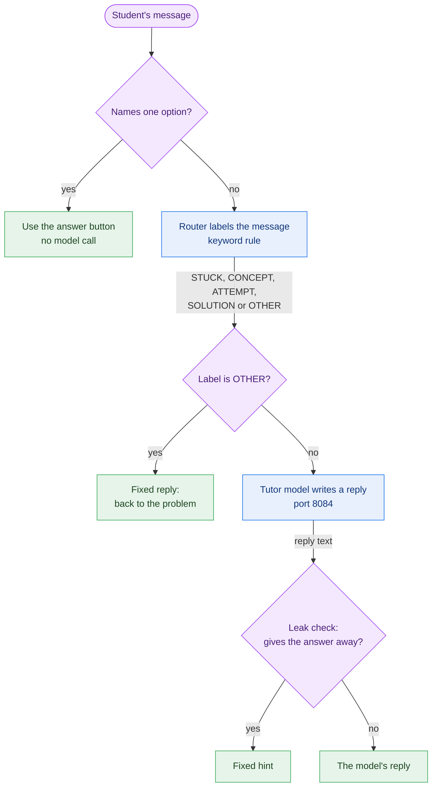
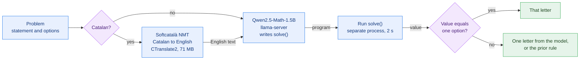

# Santolina: a math tutor that lives on the Arduino UNO Q

Santolina is a math tutor for secondary school students that runs entirely on
an Arduino UNO Q 4 GB. Each student gets a board. The board makes its own
Wi-Fi, the student opens the tutor on a phone, and a small fine-tuned model
guides them through Kangaroo problems with short questions, never with the
answer. A teacher app on a laptop loads homework onto the boards and reads back
what each student did, over USB. Nothing leaves the board.

For the hidden test, `predict.py` answers each problem with one letter, A to E.
By default it uses a fixed rule on the option values (`SOLVER=prior`), with no
model call. With `SOLVER=letter`, it asks Qwen3.5 0.8B for the letter instead.

<p align="center">
  
  &nbsp;
  
</p>

*Left: the student app on a phone, connected to the board's own Wi-Fi. A
wrong answer is greyed out, and the student tries again. Right: the teacher
app on the laptop, with the class map by topic. Both screens show made-up demo
data.*

This project is our entry to the Qualcomm challenge of the
[Datathon FME 2026](https://github.com/mpous/datathon-UPC-maths-qualcomm-arduino-unoq),
"Math on the Edge".

## Contents

1. [What it does](#what-it-does)
2. [Architecture](#architecture)
3. [How to replicate it](#how-to-replicate-it)
4. [Results](#results)
5. [Error analysis](#error-analysis)
6. [What didn't work, and what we would try next](#what-didnt-work-and-what-we-would-try-next)
7. [The team](#the-team)
8. [Credits and license](#credits-and-license)

## What it does

The challenge asks the copilot to do two things: **teach** and **reason**.

**Teach.** The student scans the QR code on the board's sticker. The phone
joins the board's Wi-Fi and opens the tutor at `http://10.42.0.1`. The student
types their code and picks homework, practice by topic, or free mode. On each
problem they can:

- tap an option and see at once if it is right,
- ask for a **clue**: the first says where to start, the second adds a
  similar, easier Kangaroo problem, and each later clue gives the next step,
- chat with the tutor in Catalan, Spanish or English,
- see the solution, but only after a wrong answer.

Code checks every reply of the model before the student sees it. If a reply
names the right option or its value, a fixed hint replaces it.

In free mode, a fixed rule picks the next problem from the retrieval index,
with no model call (`student_app/planner.py`):



"Same topic" is the nearest problem in the index. "Other topic" is the
problem farthest from the last five. The rule never shows a problem twice,
and never gives a homework problem.

Two reading switches make a problem easier to read: a font in which similar
characters such as 0 and O are hard to confuse (Atkinson Hyperlegible), and an
"easy read" layout with one sentence per line and the question last. The LED matrix shows the Wi-Fi state, and a "thinking" bar
while the model writes.

The teacher app runs on the teacher's laptop. It sets up each board, loads
exercise packs, and unloads each student's answers, clues and chat when the
board is plugged in. Students are known by a code. The board never sees their
names.

**Reason.** `predict.py` is the program the organizers run on the hidden test:
one letter, A to E, per problem, in at most 60 seconds, with no network.
`config.env` chooses how it answers:



- `SOLVER=prior` (the default): a fixed rule picks the option where the right
  answer tends to sit. Kangaroo distractors are built around the right value,
  so when the five options are distinct numbers, the rule picks the middle
  value. It calls no model, so each answer takes well under a second
  ([`copilot/prior.py`](copilot/prior.py)).
- `SOLVER=letter`: Qwen3.5 0.8B (`math-llm`, port 8081) gives one letter,
  forced by a grammar. If the model is too slow or fails, the answer is `D`
  (`FALLBACK_ANSWER` in `config.env`), with the status `timeout` or `error`.

We also tried a program solver, in which a 2B model writes a Python program
for the problem. It scored best on the practice set, but it is not in
`predict.py` on `main`. See [Results](#results).

## Architecture



Blue: our code and the models on the board. Yellow: data stored on the
board. Grey: people and devices outside the board. The dotted arrows are
optional (`SOLVER=letter`) or done once (building the index).

### What runs where

| Part | Runs on | Code |
| --- | --- | --- |
| Student app: pages, clue ladder, chat, leak check, free-mode rule | Linux, port 80, systemd `santolina-student` | [`student_app/`](student_app/) |
| Tutor model: Qwen3.5 0.8B with our fine-tune, Q8_0 | Linux, port 8084, systemd `math-tutor` | [`board/08_install_tutor.sh`](board/08_install_tutor.sh) |
| Embedding model: bge-small-en-v1.5 | Linux, port 8082, systemd `math-embed` | [`board/systemd/`](board/systemd/) |
| Retrieval index of solved M3Kang problems | Linux, `data/index.db` | [`build_index.py`](build_index.py) |
| Solver for the hidden test: the prior rule (`SOLVER=prior`, default) or one letter from the model (`SOLVER=letter`) | Linux, `predict.py` | [`copilot/pipeline.py`](copilot/pipeline.py), [`copilot/prior.py`](copilot/prior.py) |
| Base model for `SOLVER=letter`: Qwen3.5 0.8B, Q8_0 | Linux, port 8081, systemd `math-llm` | [`board/systemd/`](board/systemd/) |
| LED app: Python side | Linux, App Lab app `santolina-leds` | [`board/app-lab/santolina-leds/python/main.py`](board/app-lab/santolina-leds/python/main.py) |
| LED matrix animations | Microcontroller | [`board/app-lab/santolina-leds/sketch/sketch.ino`](board/app-lab/santolina-leds/sketch/sketch.ino) |
| Teacher app | Teacher's laptop | [`teacher_app/`](teacher_app/) |

**The Bridge.** The LED app's Python side reads the board state from the
student app, at most every 250 ms. It calls two functions on the microcontroller
with `Bridge.call`: `set_mode` (Wi-Fi off, waiting for a phone, phone
connected) and `set_thinking` (how many of the 104 LEDs the "thinking" bar
fills). The sketch draws every frame, so the animations stay smooth whatever
Linux is doing.

### How the parts work together

**A chat message, step by step** (`student_app/tutor.py`):



Green boxes are what the student sees. Only the blue tutor box calls a model.

1. A message that names one option ("is it C?") never reaches a model. The
   app asks the student to use the answer button, which counts the attempt.
2. `student_app/router.py` labels the message: `STUCK`, `CONCEPT`, `ATTEMPT`,
   `SOLUTION` or `OTHER`. Today the label comes from a keyword rule. The
   decider-2b model is tested to replace it ([Results](#results)).
3. `OTHER` gets a fixed reply that brings the student back to the problem.
   `SOLUTION` counts only when the keyword rule agrees, so a model alone never
   unlocks the solution. Every other label goes to the tutor model.
4. The tutor model (port 8084) writes one short reply. The problem and its
   answer are in the system message. The tutor reads them once, when the
   exercise opens, so each message reads only its new tokens.
5. Code checks the reply. If it names the right option, points at an option
   as the answer, or holds the right value, a fixed hint replaces it.
6. While the model writes, `/api/board-state` reports the tokens written, and
   the LED app fills the "thinking" bar on the matrix.

**One model call at a time.** The tutor server has one slot, so
`student_app/jobs.py` runs the slow tutor calls (clues, chat replies, and
reading the problem when an exercise opens) one at a time. The phone gets a
ticket at once, and asks for the result every second.

**Which models share the RAM.** At boot the board starts three llama.cpp
servers: `math-llm` (Qwen3.5 0.8B, port 8081, for `predict.py` with
`SOLVER=letter`), `math-embed` (bge-small, port 8082, for similar problems)
and `math-tutor` (the fine-tuned tutor, port 8084). With these, the student
app and the LED app running, board B1 had 2.6 GB of its 3.6 GB available. The
program solvers in [Results](#results) run their model (1.0 to 1.5 GB) in
place of `math-llm`.

**How the answer options reach `predict.py`.** In M3Kang and in the practice
set, the options A to E are only in the problem image. `predict.py` on `main`
expects them as text in its JSONL input, read on a laptop with OCR
(`laptop/prepare_m3kang.py`). The board itself reads no images on `main`.
Reading the options on the board is work in progress on
[`exp/noema-finetune`](https://github.com/Sigkaio636/Santolina_tutor/tree/02d4e4c)
(`copilot/options_ocr.py`), and not measured yet.

### How we use M3Kang

| Use | Where |
| --- | --- |
| **Similar problem.** Clue 2 finds a similar, easier solved problem in the embedding index, never a homework problem | `student_app/tutor.py`, `index.db` |
| **Adaptive path.** Free mode takes its next problem from the index: the nearest problem for "same topic", the farthest from the last five for "other topic" | `student_app/planner.py` |
| **Kangaroo library.** The teacher builds homework packs from the index, by topic and level | `teacher_app/kangaroo.py` |
| **Tutor fine-tune.** Tutor dialogues written from M3Kang problems with checked solutions, filtered in code and graded by a second model, train a LoRA on Qwen3.5 0.8B | [fine-tune record](docs/models/qwen35-tutor.md) |
| **Answer prior.** The fallback letter and the prior rule come from the answer statistics of M3Kang | `copilot/prior.py`, `config.env` |

M3Kang is licensed for research use only. No problem, image or index from it
is in this repository: see the [dataset card](https://huggingface.co/datasets/qualcomm/M3Kang).

## How to replicate it

Start from a board set up with **steps 0 to 12 of
[`docs/BOARD_SETUP.md`](docs/BOARD_SETUP.md)**. The board then runs
`math-llm` (port 8081) and `math-embed` (port 8082), and has the retrieval
index `data/index.db`. Run every command below on the board, from the
repository folder, unless the step says "laptop".

### 1. Deploy the copilot code

Follow [How to deploy the copilot on the UNO Q](docs/how-to/deploy-copilot-on-board.md).

You should see the smoke test pass at its last step.

### 2. Install the student app

```bash
./board/06_install_student_app.sh
```

It asks for the `sudo` password once. It starts the student app on port 80 at
every boot, and sends every web address on the board's Wi-Fi to it. Check it:

```bash
systemctl is-active santolina-student
curl -s -o /dev/null -w "%{http_code}\n" http://127.0.0.1/api/info
```

You should see `active`, then `200`.

### 3. Install the LED app

Run this while the board still has internet: the first start downloads App
Lab's Python image.

```bash
./board/07_install_led_app.sh
arduino-app-cli app ps
```

You should see `santolina-leds` as `running`. The matrix shows a Wi-Fi symbol
whose arcs grow while it waits for a phone.

### 4. Install the tutor model

> `qwen35-tutor-Q8_0.gguf` is not downloadable. It was trained on data made
> from M3Kang, which is for research use only, so the model stays private. To
> make your own, follow [the tutor's fine-tune record](docs/models/qwen35-tutor.md#train-it-again).
> The file on our boards has SHA256
> `fa4bdb3bc91a89ec2964a1c2ef8d9344fe5ca98f8d00e7c1768dbe9a7740ad43`.

On the laptop:

```bash
adb push qwen35-tutor-Q8_0.gguf /home/arduino/models/
```

On the board:

```bash
./board/08_install_tutor.sh
```

It starts `math-tutor.service` on port 8084 and asks the model for one clue.
You should see the clue, then a line with the prompt tokens, the tokens
written and the time for each.

### 5. Answer problems with `predict.py`

This is the command the organizers run, with the settings of `config.env`:

```bash
mkdir -p results
python3 predict.py --input data/sample_problems.jsonl --output results/check.csv
cat results/check.csv
```

You should see a header line and five rows, each with one letter from A to E,
a `seconds` value of `0.0` and the status `ok`. With the default
`SOLVER=prior`, no model is called.

To use the model instead, set the solver for one run. This needs `math-llm`
on port 8081:

```bash
SOLVER=letter python3 predict.py --input data/sample_problems.jsonl --output results/check-letter.csv
```

Each row then takes a few seconds, and stays under 60.

To measure a solver on a problem file, as in [Results](#results):

```bash
python3 eval.py --input data/demo/train.jsonl --limit 0 --languages eng --name demo-prior
```

### 6. Set up the board for a class (laptop)

On the teacher's laptop, with [uv](https://docs.astral.sh/uv/) and `adb`:

```bash
make teacher
```

The app opens at <http://127.0.0.1:8010>. Add a group and its students, plug
the board in, and click **Set up this board**. Then print the sticker and
restart the board. The full steps are in
[Run the teacher app](docs/how-to/run-teacher-app.md) and
[Use the student app](docs/how-to/use-student-app.md).

To try both apps on the laptop without a board:

```bash
uv run --group teacher python -m teacher_app demo
```

## Results

All results come from the **organizers' practice set**: 50 new
Kangaroo-style problems, each in English and Catalan, so 100 rows. Each letter
is right on 20 rows, so any fixed letter scores 20 %. **These are results on
50 problems per language.** One answer is 2 points in one language, and 1
point on the 100 rows. The practice set went to the teams only, so it is not in
this repository.

Board runs, 2026-11-15, 60-second limit per problem. The column "In
`predict.py`?" says which solvers the code on `main` can run:

| Solver | In `predict.py`? | Right of 100 | 95 % interval | English, of 50 | Catalan, of 50 | Mean time | Worst time |
| --- | --- | --- | --- | --- | --- | --- | --- |
| Noema-2B writes a program | No: experiment on a branch | 37 | 28–47 % | 20 | 17 | 43.3 s | 57.1 s |
| Noema-2B, one forced letter | No: experiment | 24 | 17–33 % | 12 | 12 | 17.7 s | 28.1 s |
| Qwen3.5 0.8B, one forced letter (organizers' baseline) | Yes, `SOLVER=letter` | 22 | 15–31 % | 12 | 10 | 7.6 s | 13.6 s |
| Any fixed letter | | 20 | | 10 | 10 | 0 s | 0 s |
| **Prior rule on option values** | **Yes, `SOLVER=prior` (the default)** | **16** | 10–24 % | 8 | 8 | 0 s | 0 s |
| decider-0.8b, one forced letter | No: experiment | 15 | 9–23 % | 9 | 6 | 7.7 s | 12.0 s |

The default on `main` scores below a fixed letter on this set. The reason is
in [What didn't work](#what-didnt-work-and-what-we-would-try-next).

The organizers' own baseline is 22.5 % (9 of 40) on 40 English M3Kang
problems whose options OCR read ([`docs/BOARD_SETUP.md`, step 11.3](docs/BOARD_SETUP.md#113-what-we-measured)).
On the practice set the same baseline scores 24 % in English.

Sources: [four solvers on the practice set](https://github.com/Sigkaio636/Santolina_tutor/blob/1049459dfdcfb8c53a261844200a743204825206/docs/experiments/2026-11-practice-set-on-board.md)
and [the program solver on the board](https://github.com/Sigkaio636/Santolina_tutor/blob/b956cf03dadb675bea796181dac01d2b77b1a38b/docs/experiments/2026-11-program-solver-and-vision-on-board.md).
We computed the interval of the program solver (Wilson, 95 %). The other
intervals come from the first report.

### Our best pipeline: Qwen2.5-Math writes a program, Catalan translated first

This is our strongest solver so far. **Its code is on the branch
[`exp/noema-finetune`](https://github.com/Sigkaio636/Santolina_tutor/tree/02d4e4c),
not in `predict.py` on `main`, and it has not run on the board yet.** The
numbers below come from a laptop that charges the board's estimated speeds.



How it answers one problem:

1. **Translate.** A Catalan statement, and any option with words, goes
   through [softcatala/translate-cat-eng](https://huggingface.co/softcatala/translate-cat-eng)
   (MIT, CTranslate2 with SentencePiece, 71 MB). The translation runs inside
   the problem's 60 s. English problems skip this step.
2. **Write a program.** [Qwen2.5-Math-1.5B-Instruct](https://huggingface.co/Qwen/Qwen2.5-Math-1.5B-Instruct)
   (Apache-2.0, Q4_K_M, 986 MB, not fine-tuned) gets a short fixed prompt with
   two made-up examples, and writes a Python `solve()`. The server keeps the
   fixed prompt in its cache, so each problem reads only its own tokens. The
   request stops the model before the time limit.
3. **Run it.** Python runs `solve()` in a separate process, for at most 2 s,
   with the standard library only.
4. **Match an option.** If the value equals exactly one option, that letter
   is the answer.
5. **Fall back.** Otherwise the model gives one letter, if time is left, or
   the prior rule answers. If a request fails, the answer is `D`.

We also fine-tuned Noema-2B and Qwen2.5-Math to write programs. Both scored
lower on the practice set than this untuned model.

Results: 60 s per problem, laptop runs at the board's estimated speeds (5.2
tokens/s reading, 3.0 tokens/s writing), 3 s charged for each translation.
"M3Kang" means held-out M3Kang problems with options that OCR read.

| | M3Kang, English | M3Kang, Catalan + NMT | Practice set, English | Practice set, Catalan + NMT |
| --- | --- | --- | --- | --- |
| **Right answers** | **36 of 83 (43 %)** | **29 of 80 (36 %)** | **29 of 50 (58 %)** | **26 of 50 (52 %)** |
| Programs whose value matches one option | 24 | 20 | 28 | 24 |
| … of those, right | 19 (79 %) | 14 (70 %) | 23 (82 %) | 20 (83 %) |
| Programs that reach the token limit | 34 | 35 | 13 | 12 |
| Programs that fail when they run | 39 | 32 | 15 | 12 |

- **Against the board results above:** on the practice set, the Noema-2B
  program solver got 20 of 50 in English and 17 of 50 in Catalan. Any fixed
  letter gets 10 of 50.
- **The program is the part that works.** When its value matches an option,
  it is right 70 % to 83 % of the time. The other right answers come from the
  fallback.
- **The translation is what helps Catalan.** On the practice set, Catalan
  went from 14 to 26 of 50 with it, and the right programs from 7 to 20.
  Without it, the model wrote no right program for the 80 Catalan M3Kang
  problems.
- **M3Kang is harder than the practice set.** More programs reach the token
  limit or fail when they run. The counts of these two rows add up to more
  than the number of problems, so one problem can count in both.
- These are laptop numbers. The board must still measure the real speed of the
  model and of the translation, and the step-by-step board test is in
  [How to try Qwen2.5-Math with Catalan translation on the board](https://github.com/Sigkaio636/Santolina_tutor/blob/02d4e4c/docs/how-to/try-qwen-math-nmt.md).

**The tutor.** These numbers come from board B1 and from our router tests:

| Measure | Value | Source |
| --- | --- | --- |
| Time to the first word of a reply | 2.5 to 7 s | [Use the student app](docs/how-to/use-student-app.md#the-copilot) |
| Time for a whole reply | 8 to 18 s, at about 5.7 tokens/s | same |
| Intent router: decider-2b against decider-0.8b, 250 student messages | 87.6 % against 80.8 % right (p = 0.009) | [router round 3](docs/experiments/2026-11-router-bakeoff-3.md) |

## Error analysis

**The solver in `predict.py` (`SOLVER=prior`).** It answers C on 90 of the 100
rows and D on 10, the same in both languages: 8 of 50 right in English and 8
of 50 in Catalan. The practice set lists its options in increasing order, so
the middle value is almost always option C, and C is right on only 20 rows.
The rule never reads the statement, so level and topic don't change its
answer.

**The program solver (experiment, not in `predict.py`).** The rest of this
section is on the board run of the program solver above (100 rows). It shows
where a solver that reads the problem fails.

**By language.** English 20 of 50 (40 %), Catalan 17 of 50 (34 %). The model
writes a program for fewer Catalan rows (20 against 23), and fewer of those
programs are right.

**By how it answered:**

| Answered by | English | Catalan |
| --- | --- | --- |
| The program's value matched one option | 14 of 23 right (61 %) | 10 of 20 right (50 %) |
| One letter after the program | 3 of 15 right (20 %) | 3 of 17 right (18 %) |
| No answer from the model | 0 of 4 | 1 of 4 |
| Timeout: the answer is D | 8 rows | 9 rows |

The program is the part that works. The letter after it is at chance.

**By difficulty (level),** English and Catalan together:

| Level | 0 | 1 | 2 | 3 | 4 | 5 | 6 | 7 |
| --- | --- | --- | --- | --- | --- | --- | --- | --- |
| Right | 4 of 16 | 7 of 16 | 5 of 14 | 3 of 12 | 6 of 12 | 4 of 10 | 1 of 10 | 7 of 10 |

Each cell holds 5 to 8 problems in two languages, so most differences between
levels can be chance. We did not find why level 7 scores highest.

**By topic: not measured.** The practice problems have no topic labels, and
we did not label them. This is the main gap in this analysis.

**A few wrong answers, explained** (problem IDs only: the practice set is not
public):

- **Timeouts.** 17 of 100 rows run out of time, and every timeout answers `D`.
  `D` is right on 20 % of the rows, so these rows are close to lost.
- **Figure problems.** The model does not see the figure: it gets only the
  statement and the options that OCR read. With the image, through the 0.8B
  vision model, the program was right on 1 of 6 figure rows. On
  `lvl-0_2026_3`, in both languages, the program returned no option.
- **The same problem, two languages.** On `lvl-1_2026_2` the vision path
  answered right in English (`D`) and wrong in Catalan (`A`).
- **Letter bias.** Of the 50 English answers, 16 are C, while C is right on
  only 10 rows. In Catalan, 15 answers are D, and D is right on 10 rows.

## What didn't work, and what we would try next

What didn't work:

- **One forced letter from a small model.** Every model we tried scored 15 to
  24 of 100, close to the 20 of a fixed letter. Each one answers mostly one
  letter: Noema-2B answers C on 84 rows, Qwen3.5 0.8B answers D on 73.
- **The prior rule.** It beat a fixed letter on M3Kang, where real papers
  rarely put the answer at the smallest or largest value. The practice set
  sorts its options, so the rule always picks C, and it scores 16 of 100.
- **Worked steps.** Noema-2B writes about 2.4 tokens per second on the board.
  132 written tokens took 81 s, which is over the 60 s limit.
- **The figure path.** It fits in time (worst 48.9 s on 6 rows), but the
  answers are wrong.
- **The program solvers stayed on branches.** The Noema-2B version scored 37
  of 100 on the board, and the Qwen2.5-Math version with translation scored
  55 of 100 on the laptop. Neither was merged into `predict.py`. Both need
  their model started by hand on port 8090, in place of `math-llm`, which the
  board does not do at boot.
- **Fine-tuning the program writers.** Fine-tuned Noema-2B and Qwen2.5-Math
  both wrote fewer right programs on the practice set than untuned
  Qwen2.5-Math.
- **The tutor's arithmetic.** The tutor model sometimes states a wrong fact,
  and it accepts a wrong step from the student. The leak check cannot catch
  that. The model cannot read photos.
- **The first intent router.** decider-0.8b had recall under 60 % on one
  label. decider-2b replaces it, and is not on the board yet.

What we would try next:

- Make `SOLVER=letter` the default: it scored 22 of 100 against 16 for the
  prior rule on the practice set.
- Run the Qwen2.5-Math pipeline with translation on the board, and bring it
  into `predict.py`, with its model as a service that starts at boot.
- Cut the programs that reach the token limit or fail when they run: on
  M3Kang they are most of the problems the program misses.
- Stop the program earlier when time is short, so the prior answers instead
  of the timeout `D`.
- Translate Catalan statements to English before the program.
- Check the numbers in a tutor reply against a verified program.
- Label the problems by topic, and report accuracy by topic.
- Run decider-2b on the board, and turn each router label into its own reply
  type.

## The team

- Eki Gonzalez
- Pau Soler
- Ferran Alia 
- Haokang Chen


## Credits and license

Our code is under the [Apache 2.0 license](LICENSE).

- Board setup, the first copilot, the scripts and four skills: the organizers
  of the UPC Datathon FME 2026 Qualcomm challenge,
  [mpous/datathon-UPC-maths-qualcomm-arduino-unoq](https://github.com/mpous/datathon-UPC-maths-qualcomm-arduino-unoq).
- **M3Kang**: Torres-Camps et al., 2026, [arXiv:2601.16218](https://arxiv.org/abs/2601.16218).
  [Dataset card and license](https://huggingface.co/datasets/qualcomm/M3Kang):
  research use only.
- [llama.cpp](https://github.com/ggml-org/llama.cpp) (MIT).
- Models: [Qwen3.5 0.8B](https://huggingface.co/bartowski/Qwen_Qwen3.5-0.8B-GGUF),
  [bge-small-en-v1.5](https://huggingface.co/CompendiumLabs/bge-small-en-v1.5-gguf),
  and, in experiments only,
  [Noema-2B](https://huggingface.co/NoemaAI-labs/Noema-2B-GGUF) (Apache 2.0),
  [Qwen2.5-Math-1.5B-Instruct](https://huggingface.co/Qwen/Qwen2.5-Math-1.5B-Instruct) (Apache 2.0)
  and [softcatala/translate-cat-eng](https://huggingface.co/softcatala/translate-cat-eng) (MIT),
  run with [CTranslate2](https://github.com/OpenNMT/CTranslate2) (MIT).
  See each model card for its license.
- [RapidOCR](https://github.com/RapidAI/RapidOCR) (Apache 2.0).
- [Atkinson Hyperlegible](https://www.brailleinstitute.org/freefont/) font,
  Braille Institute (SIL Open Font License).

**For developers:** the repository layout, the M3Kang guard, the pull request
rules and the docs site are in [`docs/DEVELOPING.md`](docs/DEVELOPING.md).
