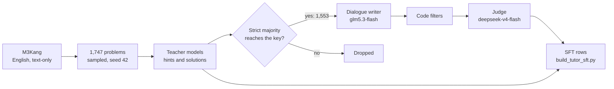

# qwen35-tutor: fine-tune record

This page records how we trained the tutor model of the student app: a LoRA
fine-tune of Qwen3.5 0.8B. It lists the data, the settings, the run that made
the model on the board, and the file itself. Add a row to the
[run log](#run-log) after each new training run.

Last updated: 2026-11-15.

## Identity

| | |
| --- | --- |
| Name | `qwen35-tutor` (llama-server alias) |
| What it is | A chat model that tutors one student on one Kangaroo problem. The teacher gives it the problem and the correct answer. It writes hints, a solution, and short guiding replies. |
| Base model | [Qwen/Qwen3.5-0.8B](https://huggingface.co/Qwen/Qwen3.5-0.8B). The revision was not pinned: the run took the latest one on 2026-11-15. |
| Method | LoRA on every linear layer, merged into the base weights, then converted to GGUF Q8_0 |
| Training language | English only |
| Where it runs | The board, `math-tutor.service`, port 8084 |
| Who calls it | `student_app/tutor.py`: clues, chat replies |
| Availability | **Private.** The training data comes from M3Kang, which is for research use only. The data and the model stay off any public site. |

## The file on the board

| File | Size | SHA256 |
| --- | --- | --- |
| `qwen35-tutor-Q8_0.gguf` | 811,843,232 bytes (812 MB) | `fa4bdb3bc91a89ec2964a1c2ef8d9344fe5ca98f8d00e7c1768dbe9a7740ad43` |

What the GGUF header says: architecture `qwen35`, size label `752M`, 25
blocks, file type Q8_0, `nextn_predict_layers = 1` (the converter kept the
multi-token prediction head). The file came from the Kaggle output of the
[short run](#run-log), which wrote it at 05:23 UTC on 2026-11-15.

The board serves it with these `llama-server` options
([`board/systemd/math-tutor.service`](https://github.com/Sigkaio636/Santolina_tutor/blob/main/board/systemd/math-tutor.service)):
`--ctx-size 2048 --parallel 1 --cache-ram 0 --ctx-checkpoints 2 --jinja --reasoning off --reasoning-budget 0`.
`--reasoning off` matters: the model was trained without thinking.

## How the training data was made

All the code is on the branch `feat/tutor-finetune`, commit
[`64e56f5`](https://github.com/Sigkaio636/Santolina_tutor/tree/64e56f5337819ef1e43d66f8a32605a8f5899eb9).
The data stays in `data/processed/`, which Git ignores. The counts below are
aggregates only.



### 1. Hints and solutions from teacher models

[`santolina_tutor/generate_explanations.py`](https://github.com/Sigkaio636/Santolina_tutor/blob/64e56f5337819ef1e43d66f8a32605a8f5899eb9/santolina_tutor/generate_explanations.py)
sends each problem to large models through the Helmcode API (OpenAI
compatible). Each call gets the problem text, its image (the options are only
in the image) and the official answer letter. The model returns one JSON
object: the options, the topic, the key idea, three hints from gentle to
concrete, the solution steps, the final letter, common mistakes, and whether
it agrees with the official key.

| Measure | Value |
| --- | --- |
| Problems sampled | 1,747, English, text-only, seed 42 |
| Problems per level, 0 to 7 | 142, 106, 146, 123, 339, 296, 305, 290 |
| Teachers that wrote training text | glm5.3-flash (first choice), deepseek-v4-flash |
| Other teachers that only voted | qwen3.6 (60 problems), gemma4 (37 problems) |
| Trust rule | A problem is kept only if a strict majority of the teachers that answered reached the official key on their own. This drops problems with a wrong key or a broken text. |
| Problems with a disputed key | 19, always excluded |
| **Trusted problems** | **1,553** |
| Rows written | 4,670 hint rows and 1,553 solution rows: 5,886 from glm5.3-flash, 337 from deepseek-v4-flash |

### 2. Tutor dialogues

[`santolina_tutor/generate_dialogues.py`](https://github.com/Sigkaio636/Santolina_tutor/blob/64e56f5337819ef1e43d66f8a32605a8f5899eb9/santolina_tutor/generate_dialogues.py)
asks glm5.3-flash to write short tutor-student exchanges for each trusted
problem. The writer gets the official answer and the checked solution, and
does not solve the problem again. The exchange types come from
[Tutor response types](../TUTOR_RESPONSE_TYPES.md): a vague message, a
concept question, a wrong attempt in three stages (question, pointer,
correction), questions after the solution, free questions about a step, and
"just tell me the letter".

Each item then goes through two checks:

1. **Code filters.** They drop a tutor message that names the correct option,
   holds the correct value, refers to a solution the student has not seen,
   thinks aloud, is too long, is empty, or does not end with a question.
2. **A judge model,** deepseek-v4-flash, scores each item against the rules
   of the tutoring guide.

Final report of the generation run (2026-11-15, 06:05):

| Item | Kept | Code-filtered | Judge failed |
| --- | --- | --- | --- |
| diagnostic | 3,480 of 3,939 | 194 | 265 |
| concept | 1,671 of 1,832 | 75 | 86 |
| error: question | 2,643 of 3,219 | 329 | 247 |
| error: pointer | 2,336 of 3,219 | 747 | 136 |
| error: correction | 2,643 of 3,219 | 295 | 281 |
| after solution | 2,728 of 4,627 | 506 | 1,393 |
| free question | 4,111 of 4,672 | 245 | 313 |
| manipulation | 1,303 of 1,549 | 132 | 112 |

The most common reasons to filter: "refers to the solution the student has
not seen" (769), "does not end with a question" (719), "empty" (440), "contains
the correct value" (244), "too long" (207). An error dialogue is used only
when all three of its stages pass.

The short run's set was built at 04:55, before the judge finished. At that
time 1,137 problems had judged dialogues, 412 had dialogues that passed the
code filters only (`--allow-unjudged`), and 4 had none.

### 3. Training rows

[`laptop/build_tutor_sft.py`](https://github.com/Sigkaio636/Santolina_tutor/blob/64e56f5337819ef1e43d66f8a32605a8f5899eb9/laptop/build_tutor_sft.py)
turns the hints, solutions and dialogues into chat rows. Each row ends with
one tutor reply, and the loss uses only that reply. The system prompt holds
the problem, the teacher's answer and the tutor's rules. The board builds the
same prompt with
[`copilot/tutor_prompt.py`](https://github.com/Sigkaio636/Santolina_tutor/blob/64e56f5337819ef1e43d66f8a32605a8f5899eb9/copilot/tutor_prompt.py),
so the model sees on the board what it saw in training.

Tasks and their loss weights:

| Task | What the tutor does | Weight |
| --- | --- | --- |
| `prepare` | Writes all hints and the solution in one go, when the teacher enters a problem | 1.0 |
| `error_question` | Answers a wrong attempt with a question that shows the contradiction | 1.0 |
| `free` | Answers a specific question about a step | 1.0 |
| `diagnostic` | Answers a vague message with one question about the problem | 0.8 |
| `concept` | Explains a term with another example, then asks a question | 0.8 |
| `error_pointer` | Points at the faulty step after a second wrong attempt | 0.8 |
| `correction` | Corrects the step, but leaves the last step to the student | 0.8 |
| `hint` | Gives hint *k* after hints 1 to *k*−1 | 0.6 |
| `solution` | Gives the full solution when asked | 0.6 |
| `manipulation` | Refuses "just tell me the letter", and goes back to the problem | 0.5 |
| `check_right` | Confirms a correct answer and asks why | 0.5 |
| `key_idea` | Names the main idea | 0.4 |
| `solve_nokey` | Solves without the key (left out of the short run) | 0.3 |

The validation split is by problem: 155 problems (10 %, seed 42), the same in
every set. No validation problem is in the training rows.

| Set | Built with | Train rows | Val rows |
| --- | --- | --- | --- |
| `tutor_sft` (full) | default | 21,331 | 2,389 |
| `tutor_sft_lean` | `--lean` | 15,799 | 1,769 |
| **`tutor_sft_small`** (on the board) | `--allow-unjudged --lean --sample 0.2` | **3,148** | **320** |

`--lean` drops `solve_nokey`, keeps hint levels 1 and 2 only, half of
`check_right` and `key_idea`, and one free question per problem instead of
two. `--sample 0.2` keeps 20 % of the problems: the short set has 290
problems (262 train, 28 val, one `prepare` row each).

Rows per task in the short set (train / val): `hint` 563 / 75,
`free` 292 / 24, `manipulation` 269 / 29, `solution` 269 / 26,
`diagnostic` 266 / 25, `concept` 266 / 31, `prepare` 262 / 28,
`error_question` 233 / 21, `error_pointer` 220 / 20, `correction` 211 / 19,
`check_right` 150 / 14, `key_idea` 147 / 8.

## Training

Script:
[`kaggle/train_tutor.py`](https://github.com/Sigkaio636/Santolina_tutor/blob/64e56f5337819ef1e43d66f8a32605a8f5899eb9/kaggle/train_tutor.py).
Notebook of the short run:
[`kaggle/tutor_finetune_small.ipynb`](https://github.com/Sigkaio636/Santolina_tutor/blob/64e56f5337819ef1e43d66f8a32605a8f5899eb9/kaggle/tutor_finetune_small.ipynb).
The data went to Kaggle as a private dataset.

| Setting | Short run (on the board) | Script default |
| --- | --- | --- |
| Hardware | Kaggle, 2 × T4 (`torchrun`, 2 processes) | |
| Precision | fp32 weights, fp16 autocast (the T4 has no bf16) | bf16 where the GPU has it |
| LoRA | r = 32, alpha = 64, dropout 0.05, every linear layer (attention, Gated DeltaNet, MLP). Embeddings and LM head frozen. | same |
| Loss | Cross-entropy on the last reply only, averaged per example, times the task weight | same |
| Epochs | 1, stopped after 70 min at most (`MAX_MINUTES=70`) | 2 |
| Batch | 4 per GPU × 2 accumulation × 2 GPUs = 16 rows per step | 4 × 4 accumulation |
| Steps planned | 197 (one epoch), fewer if the 70 min ran out | |
| Learning rate | 2e-4, cosine, 9 warm-up steps, no weight decay, gradient clip 1.0 | same |
| Longest row | 3,072 tokens; longer rows dropped | same |
| Evaluations | 4, each saving a LoRA checkpoint | 2 |
| Checkpoint kept | The one with the lowest weighted validation loss | same |
| Seed | 42 | 42 |
| Libraries | `transformers>=5`, `peft`, `accelerate`, `flash-linear-attention` | |

After training, the script merges the best adapter into the base model and
saves it in bf16. The notebook converts it with `convert_hf_to_gguf.py` of
llama.cpp `2cbe0ec` (the commit pinned in `config.env`), `--outtype q8_0`.

## Run log

| Date | Run | Data | Steps reached | Best checkpoint | Val loss (weighted) | Training time | Output |
| --- | --- | --- | --- | --- | --- | --- | --- |
| 2026-11-15 | Short run, `tutor_finetune_small.ipynb` | `tutor_sft_small` | 178 of 197 (0.90 epoch), stopped by `MAX_MINUTES=70` | `checkpoint-178` | 0.9692 | 4,293 s | `qwen35-tutor-Q8_0.gguf`, on the board |

The full set (`tutor_sft`) was built but not trained.

## Results of the short run

Source: the output of the Kaggle notebook run (Papermill), which started on
2026-11-15 at 04:04 UTC and ended at 05:23 UTC (4,778 s in all).

| Measure | Value |
| --- | --- |
| GPUs | 2 |
| Training rows | 3,148, 1,595,934 tokens. None dropped for length. |
| Validation rows | 320, 158,441 tokens. None dropped for length. |
| Trainable parameters | 21,645,312 of 774,038,336 (2.80 %) |
| Speed | About 18 s per step, 0.663 rows/s |
| Where it stopped | Step 178 of 197: the 70-minute limit came first |
| Mean training loss | 1.069 |
| Checkpoint kept | `checkpoint-178`, the last one, which also had the lowest validation loss |

Weighted validation loss at each evaluation, on all 320 validation rows:

| Step | 49 | 98 | 147 | 178 |
| --- | --- | --- | --- | --- |
| Validation loss | 1.049 | 1.003 | 0.9772 | 0.9692 |

The loss was still going down at the last evaluation, so the run stopped
before it flattened.

Validation loss per task of the kept checkpoint (not weighted, lower is
better):

| Task | Loss |
| --- | --- |
| `check_right` | 0.3984 |
| `solution` | 0.6772 |
| `prepare` | 0.786 |
| `manipulation` | 1.2673 |
| `key_idea` | 1.2842 |
| `concept` | 1.3865 |
| `hint` | 1.4625 |
| `diagnostic` | 1.5014 |
| `error_pointer` | 1.5213 |
| `error_question` | 1.5412 |
| `correction` | 1.5808 |
| `free` | 1.7218 |

The tasks with long, structured answers (`solution`, `prepare`) have the
lowest loss. The short live replies (`free`, `correction`, the error stages)
have the highest. The run did not measure the base model's loss on the same
rows, so these numbers show progress inside the run, not the gain over
Qwen3.5 0.8B.

**Conversion.** The GGUF writer reported 320 tensors and 800.9M bytes, and
"Model successfully exported". During the Q8_0 step, gguf-py printed
`RuntimeWarning: overflow encountered in divide` and `invalid value
encountered in cast` (`quants.py`). We did not check which tensors caused
them. The model runs on board B1 with the times in
[Behaviour on the board](#behaviour-on-the-board).

## Behaviour on the board

From [Use the student app](../how-to/use-student-app.md#the-copilot),
board B1:

| Measure | Value |
| --- | --- |
| Time to the first word | 2.5 to 7 s |
| Time for a whole reply | 8 to 18 s, at about 5.7 tokens/s |
| Prompt reading | About 11.5 tokens/s |

Known limits:

- It cannot check the student's arithmetic. It accepts a wrong step, and
  sometimes states a wrong fact itself. The leak check in
  `student_app/tutor.py` blocks a named answer, not a wrong fact.
- It does not write reliable worked solutions, so the app shows the pack's
  own solution instead.
- It was trained in English only. The app also runs in Catalan and Spanish,
  and asks the model to reply in the language of the visit. We did not measure
  the quality of those replies.
- No tutoring quality score exists yet: only the validation loss and the
  replies to five validation problems that the notebook prints for a check by
  hand. Those replies stay in Kaggle, because they hold problem text.

## Train it again

You need access to M3Kang, a Helmcode API key in `HELMCODE_API_KEY`, and a
Kaggle account with GPUs. On the laptop, on branch `feat/tutor-finetune`:

```bash
uv run python -m santolina_tutor.generate_explanations --n 1747 --languages eng --models glm5.3-flash,deepseek-v4-flash
uv run python -m santolina_tutor.generate_dialogues --n 0
uv run python laptop/build_tutor_sft.py --allow-unjudged --lean --sample 0.2 --out data/processed/tutor_sft_small
```

The exact options of the first two commands in the original run were not
recorded. The values above match the data: 1,747 English problems, and
training text from glm5.3-flash and deepseek-v4-flash. qwen3.6 and gemma4 also
voted on a few problems; add them with `--tiebreak` or `--models` if you want
the same vote. The third command is the one in the notebook.

The last command writes `data/processed/tutor_sft_small/`, with a copy of
`train_tutor.py`. Upload that folder to Kaggle as a **private** dataset,
attach it to `kaggle/tutor_finetune_small.ipynb`, set **GPU T4 x2** and
**Internet on**, and run **Save Version → Save & Run All (Commit)**. The
output holds `qwen35-tutor-Q8_0.gguf`. Copy it to the board as in
[Use the student app](../how-to/use-student-app.md#the-copilot).

The API models change over time, so a new run gives different data. The SHA256
above identifies the model that runs on the board now.
