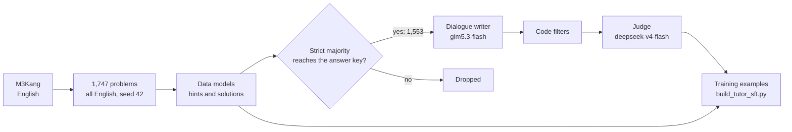

# qwen35-tutor: fine-tune record

This page records how we trained the tutor model of the student app: a LoRA
fine-tune of Qwen3.5 0.8B. It lists the data, the settings, the run that made
the model on the board, and the file itself. Add a row to the
[run log](#run-log) after each new training run, as in
[How to add a run](#how-to-add-a-run).

Write no problem text, ids or images on this page: the training data comes
from M3Kang, which is for research use only (see the
[dataset card](https://huggingface.co/datasets/qualcomm/M3Kang)). The counts
below are aggregates only.

Last updated: 2026-11-15.

## Identity

| | |
| --- | --- |
| Name | `qwen35-tutor` (llama-server alias) |
| What it is | A chat model that tutors one student on one Kangaroo problem. It writes hints, a solution, and short guiding replies. In training, the system prompt gave it the problem and the answer key; the board gives it less (see [the prompt](#the-prompt-in-training-and-on-the-board)). |
| Base model | [Qwen/Qwen3.5-0.8B](https://huggingface.co/Qwen/Qwen3.5-0.8B). The revision was not pinned: the run took the latest one on 2026-11-15. |
| Method | LoRA on every linear layer, merged into the base weights, then converted to GGUF Q8_0 |
| Training language | English only |
| Where it runs | The board, `math-tutor.service`, port 8084 |
| Who calls it | `student_app/tutor.py`: clues, chat replies |
| Availability | **Private.** The training data comes from M3Kang, which is for research use only. The data and the model stay off any public site. |

## Files

| File | Size | SHA256 |
| --- | --- | --- |
| `qwen35-tutor-Q8_0.gguf` | 811,843,232 bytes (812 MB) | `fa4bdb3bc91a89ec2964a1c2ef8d9344fe5ca98f8d00e7c1768dbe9a7740ad43` |

What the GGUF header says: architecture `qwen35`, size label `752M`, 25
blocks, file type Q8_0, `nextn_predict_layers = 1` (the converter kept the
multi-token prediction head). The file came from the Kaggle output of the
[short run](#run-log), which wrote it at 05:23 UTC on 2026-11-15.

The file is not downloadable. On the board it goes in `~/models/`
(`MODELS_DIR` and `TUTOR_FILE` in `config.env`).

## How to run it

- Install: [Use the student app](../how-to/use-student-app.md#the-copilot)
  gives the copy command and `board/08_install_tutor.sh`, which installs and
  starts `math-tutor.service`.
- The service runs `llama-server` with these options
  ([`board/systemd/math-tutor.service`](https://github.com/Sigkaio636/Santolina_tutor/blob/main/board/systemd/math-tutor.service)):
  `--ctx-size 2048 --parallel 1 --cache-ram 0 --ctx-checkpoints 2 --jinja --reasoning off --reasoning-budget 0`.
- `--reasoning off` matters: the model was trained without reasoning
  ("thinking") output.
- The board sends a different system prompt than the training data: see
  [the prompt](#the-prompt-in-training-and-on-the-board).

## Resources

| Measure | Value |
| --- | --- |
| Server RAM on the board | Not measured |
| Context and threads | 2048 tokens, 4 threads (`TUTOR_CTX`, `TUTOR_THREADS` in `config.env`) |
| Reply times on the board | In [Use the student app](../how-to/use-student-app.md#the-copilot) |

## Verdict

**In use** as the tutor model of the student app on the board. What is not
known yet:

- No tutoring quality score exists: only the validation loss and the replies
  to five held-out problems that the notebook prints for a check by hand.
  Those replies stay in Kaggle, because they hold problem text.
- It was trained in English only. The app also runs in Catalan and Spanish,
  and asks the model to reply in the language of the session. We did not
  measure the quality of those replies.
- The board sends a shorter prompt than the training prompt
  ([details](#the-prompt-in-training-and-on-the-board)).
- The validation loss was still going down when the run stopped.

The limits that a demo shows (arithmetic, worked solutions, photos) are in
[Use the student app](../how-to/use-student-app.md#the-copilot).

## Run log

| Date | Run | Data | Steps reached | Best checkpoint | Val loss (weighted) | Training time | Output |
| --- | --- | --- | --- | --- | --- | --- | --- |
| 2026-11-15 | Short run, `tutor_finetune_small.ipynb` | `tutor_sft_small` | 178 of 197 (0.90 epoch), stopped by `MAX_MINUTES=70` | `checkpoint-178` | 0.9692 | 4,293 s | `qwen35-tutor-Q8_0.gguf`, on the board |

The full set (`tutor_sft`) was built but not trained.

### Results of the short run

Source: the output of the Kaggle notebook run (the Papermill log), which
started on 2026-11-15 at 04:04 UTC and ended at 05:23 UTC (4,778 s in all).

| Measure | Value |
| --- | --- |
| GPUs | 2 |
| Training examples | 3,148, 1,595,934 tokens. None dropped for length. |
| Held-out examples | 320, 158,441 tokens. None dropped for length. |
| Trainable parameters | 21,645,312 of 774,038,336 (2.80 %) |
| Speed | About 18 s per step, 0.663 examples/s |
| Where it stopped | Step 178 of 197: the 70-minute limit came first |
| Mean training loss | 1.069 |
| Checkpoint kept | `checkpoint-178`, the last one, which also had the lowest validation loss |

The speed and time figures are as reported by the run log. They do not agree:
4,293 s / 178 steps and 16 examples / 0.663 examples/s both give about 24 s
per step, not 18 s, and 4,293 s is more than 70 minutes.

Weighted validation loss at each evaluation, on all 320 held-out examples:

| Step | 49 | 98 | 147 | 178 |
| --- | --- | --- | --- | --- |
| Validation loss | 1.049 | 1.003 | 0.9772 | 0.9692 |

The loss was still going down at the last evaluation, so the run stopped
before it flattened.

Validation loss per task of the kept checkpoint (not weighted, lower is
better):

| Task | Loss |
| --- | --- |
| `check_right` | 0.3984 |
| `solution` | 0.6772 |
| `prepare` | 0.786 |
| `manipulation` | 1.2673 |
| `key_idea` | 1.2842 |
| `concept` | 1.3865 |
| `hint` | 1.4625 |
| `diagnostic` | 1.5014 |
| `error_pointer` | 1.5213 |
| `error_question` | 1.5412 |
| `correction` | 1.5808 |
| `free` | 1.7218 |

`check_right` has the lowest loss, then the long, structured answers
(`solution`, `prepare`). The short live replies (`free`, `correction`, the
error stages) have the highest. The run did not measure the base model's loss
on the same examples, so these numbers show progress inside the run, not the
gain over Qwen3.5 0.8B.

**Conversion.** The GGUF writer reported 320 tensors and 800.9M bytes, and
"Model successfully exported". During the Q8_0 step, gguf-py printed
`RuntimeWarning: overflow encountered in divide` and `invalid value
encountered in cast` (`quants.py`). We did not check which tensors caused
them. The model runs on the board with the reply times in
[Use the student app](../how-to/use-student-app.md#the-copilot).

## How the training data was made

All the code is on the branch `feat/tutor-finetune`, commit
[`64e56f5`](https://github.com/Sigkaio636/Santolina_tutor/tree/64e56f5337819ef1e43d66f8a32605a8f5899eb9).
That branch is not merged. The data stays in `data/processed/`, which Git
ignores.



### 1. Hints and solutions from data models

[`santolina_tutor/generate_explanations.py`](https://github.com/Sigkaio636/Santolina_tutor/blob/64e56f5337819ef1e43d66f8a32605a8f5899eb9/santolina_tutor/generate_explanations.py)
sends each problem to large models (the data models) through the Helmcode
API, an OpenAI-compatible service that hosts them. Each call gets:

- the problem text;
- its image (the options are only in the image);
- the answer key (the official letter).

The model returns one JSON object: the options, the topic, the key idea,
three hints from gentle to concrete, the solution steps, the final letter,
common mistakes, and whether it agrees with the answer key.

| Measure | Value |
| --- | --- |
| Problems | All 1,747 English problems (811 text-only, the rest with a figure), seed 42 |
| Problems per level, 0 to 7 | 142, 106, 146, 123, 339, 296, 305, 290 |
| Data models that wrote training text | glm5.3-flash (first choice), deepseek-v4-flash |
| Other data models that only voted | qwen3.6 (60 problems), gemma4 (37 problems) |
| Trust rule | A problem is kept only if a strict majority of the data models that answered reached the answer key on their own. This drops problems with a wrong key or a broken text. |
| Problems with a disputed key | 19, always excluded |
| **Trusted problems** | **1,553** |
| Examples written | 4,670 hint examples and 1,553 solution examples: 5,886 from glm5.3-flash, 337 from deepseek-v4-flash |

The hint count is as reported by the generation run: three hints for each of
1,553 problems is 4,659, not 4,670.

### 2. Tutor dialogues

[`santolina_tutor/generate_dialogues.py`](https://github.com/Sigkaio636/Santolina_tutor/blob/64e56f5337819ef1e43d66f8a32605a8f5899eb9/santolina_tutor/generate_dialogues.py)
asks glm5.3-flash to write short tutor-student exchanges for each trusted
problem. The writer gets the answer key and the checked solution, and does
not solve the problem again. The exchange types come from
[Tutor response types](../TUTOR_RESPONSE_TYPES.md). The table below lists
them.

Each item then goes through two checks:

1. **Code filters.** They drop a tutor message that names the correct option,
   holds the correct value, refers to a solution the student has not seen,
   thinks aloud, is too long, is empty, or does not end with a question.
2. **A judge model,** deepseek-v4-flash, scores each item against the rules
   of the tutoring guide.

Final report of the generation run (2026-11-15, 06:05; the time zone was not
recorded):

| Item | Training task | Kept | Code-filtered | Judge failed |
| --- | --- | --- | --- | --- |
| diagnostic (a vague message) | `diagnostic` | 3,480 of 3,939 | 194 | 265 |
| concept (a concept question) | `concept` | 1,671 of 1,832 | 75 | 86 |
| error: question | `error_question` | 2,643 of 3,219 | 329 | 247 |
| error: pointer | `error_pointer` | 2,336 of 3,219 | 747 | 136 |
| error: correction | `correction` | 2,643 of 3,219 | 295 | 281 |
| after solution | the closing question of `solution` and `prepare` | 2,728 of 4,627 | 506 | 1,393 |
| free question about a step | `free` | 4,111 of 4,672 | 245 | 313 |
| manipulation ("just tell me the letter") | `manipulation` | 1,303 of 1,549 | 132 | 112 |

The counts are as reported by the generation run. Two rows do not add up:
`free` gives 4,669, not 4,672, and `manipulation` gives 1,547, not 1,549.

The most common reasons to filter: "refers to the solution the student has
not seen" (769), "does not end with a question" (719), "empty" (440), "contains
the correct value" (244), "too long" (207). An error dialogue is used only
when all three of its stages pass.

`tutor_sft_small` was built at 04:55, before the judge finished (the time zone
was not recorded; training started at 04:04 UTC). At that time:

- 1,137 problems had judged dialogues;
- 412 had dialogues that passed the code filters only (`--allow-unjudged`);
- 4 had none.

### 3. Training examples

[`laptop/build_tutor_sft.py`](https://github.com/Sigkaio636/Santolina_tutor/blob/64e56f5337819ef1e43d66f8a32605a8f5899eb9/laptop/build_tutor_sft.py)
turns the hints, solutions and dialogues into chat examples for supervised
fine-tuning (SFT). Each example ends with one tutor reply, and the loss uses
only that reply.

#### The prompt in training and on the board

The system prompt holds the problem, the answer key and the tutor's rules.
[`copilot/tutor_prompt.py`](https://github.com/Sigkaio636/Santolina_tutor/blob/64e56f5337819ef1e43d66f8a32605a8f5899eb9/copilot/tutor_prompt.py)
builds it, and
[`copilot/tutor_backend.py`](https://github.com/Sigkaio636/Santolina_tutor/blob/64e56f5337819ef1e43d66f8a32605a8f5899eb9/copilot/tutor_backend.py)
uses it at inference. Both exist only on the `feat/tutor-finetune` branch,
which is not merged.

The student app on the board does not use this prompt yet.
`student_app/tutor.py` sends a shorter one: "You are a Socratic math tutor.",
the reply language and the problem, without the answer or the rules. So the
model sees a different prompt on the board than in training. The validation
losses on this page were measured with the training prompt, not with the
board's prompt.

#### Tasks

Tasks, their loss weights, and their examples in `tutor_sft_small`:

| Task | What the tutor does | Weight | Training | Held-out |
| --- | --- | --- | --- | --- |
| `prepare` | Writes all hints and the solution in one go. On the branch, `copilot/tutor_backend.py` sends it once per exercise; the student app on the board does not use it. | 1.0 | 262 | 28 |
| `error_question` | Answers a wrong attempt with a question that shows the contradiction | 1.0 | 233 | 21 |
| `free` | Answers a specific question about a step | 1.0 | 292 | 24 |
| `diagnostic` | Answers a vague message with one question about the problem | 0.8 | 266 | 25 |
| `concept` | Explains a term with another example, then asks a question | 0.8 | 266 | 31 |
| `error_pointer` | Points at the faulty step after a second wrong attempt | 0.8 | 220 | 20 |
| `correction` | Corrects the step, but leaves the last step to the student | 0.8 | 211 | 19 |
| `hint` | Gives hint *k* after hints 1 to *k*−1 | 0.6 | 563 | 75 |
| `solution` | Gives the full solution when asked | 0.6 | 269 | 26 |
| `manipulation` | Refuses "just tell me the letter", and goes back to the problem | 0.5 | 269 | 29 |
| `check_right` | Confirms a correct answer and asks why | 0.5 | 150 | 14 |
| `key_idea` | Names the main idea | 0.4 | 147 | 8 |
| `solve_nokey` | Solves without the answer key | 0.3 | — | — |

The held-out problems are 155 problems (10 %, seed 42), chosen by problem and
the same in every set. They are not `data/val.jsonl`. No held-out problem is
in the training examples.

| Set | Built with | Training examples | Held-out examples |
| --- | --- | --- | --- |
| `tutor_sft` (full) | default | 21,331 | 2,389 |
| `tutor_sft_lean` | `--lean` | 15,799 | 1,769 |
| **`tutor_sft_small`** (on the board) | `--allow-unjudged --lean --sample 0.2` | **3,148** | **320** |

`--lean` drops `solve_nokey`, keeps hint levels 1 and 2 only, half of
`check_right` and `key_idea`, and one free question per problem instead of
two. `--sample 0.2` then keeps each example with a chance of 20 %, after the
split. So `tutor_sft_small` holds about a fifth of the examples of
`tutor_sft_lean`, drawn from all trusted problems, and not every problem keeps
its `prepare` example.

## Training

Script:
[`kaggle/train_tutor.py`](https://github.com/Sigkaio636/Santolina_tutor/blob/64e56f5337819ef1e43d66f8a32605a8f5899eb9/kaggle/train_tutor.py).
Notebook of the short run:
[`kaggle/tutor_finetune_small.ipynb`](https://github.com/Sigkaio636/Santolina_tutor/blob/64e56f5337819ef1e43d66f8a32605a8f5899eb9/kaggle/tutor_finetune_small.ipynb).
The data went to Kaggle as a private dataset.

| Setting | Short run (on the board) | Script default |
| --- | --- | --- |
| Hardware | Kaggle, 2 × T4 (`torchrun`, 2 processes) | |
| Precision | fp32 weights, fp16 autocast (the T4 has no bf16) | bf16 where the GPU has it |
| LoRA | r = 32, alpha = 64, dropout 0.05, every linear layer (attention, the Gated DeltaNet layers of Qwen3.5, MLP). Embeddings and the output layer (LM head) frozen. | same |
| Loss | Cross-entropy on the last reply only, averaged per example, times the task weight | same |
| Epochs | 1, stopped after 70 min at most (`MAX_MINUTES=70`) | 2 |
| Batch | 4 per GPU × 2 gradient-accumulation steps × 2 GPUs = 16 examples per step | 4 × 4 accumulation |
| Steps planned | 197 (one epoch), fewer if the 70 min ran out | |
| Learning rate | 2e-4, cosine decay, 9 warm-up steps, no weight decay, gradient clip 1.0 | same |
| Longest example | 3,072 tokens; longer examples dropped | same |
| Evaluations | 4, each saving a LoRA checkpoint | 2 |
| Checkpoint kept | The one with the lowest weighted validation loss | same |
| Seed | 42 | 42 |
| Libraries | `transformers>=5`, `peft`, `accelerate`, `flash-linear-attention` | |

After training, the script merges the best LoRA adapter into the base model
and saves it in bf16. The notebook converts it with `convert_hf_to_gguf.py` of
llama.cpp `2cbe0ec` (the commit pinned in `config.env`), `--outtype q8_0`.

## How to add a run

You need access to M3Kang, a Helmcode API key, and a Kaggle account with GPUs.
The API models change over time, so a new run gives different data. The exact
options of steps 3 and 4 in the original run were not recorded; the values
below match its data.

1. On the laptop, switch to the branch with the code:
   `git switch feat/tutor-finetune`.
   Check: `git log -1 --format=%h` shows `64e56f5` or a later commit.
2. Put the M3Kang parquet files in `data/raw/` (see the
   [dataset card](https://huggingface.co/datasets/qualcomm/M3Kang)), then run
   `uv run python -m santolina_tutor.dataset`.
   Check: `data/interim/m3kang/problems.jsonl` exists.
3. Set `HELMCODE_API_KEY`, then run:

   ```bash
   uv run python -m santolina_tutor.generate_explanations --n 1747 --languages eng --no-text-only --models glm5.3-flash,deepseek-v4-flash
   ```

   To get the same vote as the original run, also add qwen3.6 and gemma4
   with `--tiebreak` or `--models`.
   Check: `wc -l data/processed/explanations/sample.jsonl` gives 1747.
4. Write the dialogues for every trusted problem:

   ```bash
   uv run python -m santolina_tutor.generate_dialogues --n 0
   ```

   Check: `uv run python -m santolina_tutor.generate_dialogues --show 0`
   prints the pass report. Compare it with the table in
   [Tutor dialogues](#2-tutor-dialogues).
5. Build the training set (the command in the notebook):

   ```bash
   uv run python laptop/build_tutor_sft.py --allow-unjudged --lean --sample 0.2 --out data/processed/tutor_sft_small
   ```

   Check: the script prints the examples per task. Compare them with the
   [Tasks](#tasks) table.
6. Upload `data/processed/tutor_sft_small/` (it holds a copy of
   `train_tutor.py`) to Kaggle as a **private** dataset.
7. Attach it to `kaggle/tutor_finetune_small.ipynb`. Set **GPU T4 x2** and
   **Internet on**.
8. Run **Save Version → Save & Run All (Commit)**.
   Check: the output holds `qwen35-tutor-Q8_0.gguf`, and the log says
   "Model successfully exported".
9. Run `sha256sum qwen35-tutor-Q8_0.gguf`. Add a row to the
   [run log](#run-log), and put the new size and SHA256 in [Files](#files).
   Write no problem text, ids or images on this page.
10. Copy the file to the board as in
    [Use the student app](../how-to/use-student-app.md#the-copilot).
    Check: `board/08_install_tutor.sh` ends with one clue from the model.
