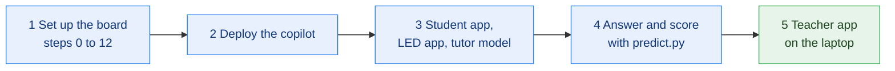

# Rebuild the shipped build

These five tutorials take a fresh Arduino UNO Q 4 GB to the build on `main`, the build we submit. Follow them in order. Each one ends with a check. Don't start the next tutorial until that check passes.

The tutorials cover only what `main` ships. The experiments that are not on `main`, for example the Qwen2.5-Math program solver, are in [Experiments](../experiments/index.md).

## What you have at the end

- **Teach.** The board makes its own Wi-Fi. A student scans the QR code on the board and opens the tutor on a phone. The fine-tuned tutor model `qwen35-tutor` (Qwen3.5 0.8B) gives clues and chat replies. The LED matrix shows the Wi-Fi state.
- **Reason.** `predict.py` answers each problem with one letter, A to E. It uses the settings of `config.env`: `SOLVER=prior`, a fixed rule on the option values that calls no model. This is the configuration the organizers run on the hidden test.
- **Class.** The teacher app on a laptop sets up the board, loads homework and unloads what the students did, over USB.

## What you need

| Item | Notes |
| --- | --- |
| Arduino UNO Q 4 GB, and its USB-C cable | A wall power supply. When USB power drops, the board restarts. |
| Linux laptop | `git`, [uv](https://docs.astral.sh/uv/) and `adb`. The M3Kang download and the OCR in tutorial 1 run on the laptop. |
| Internet | Only during setup: for the models, for App Lab's Python image and for M3Kang. After setup, the board needs no network. |
| `qwen35-tutor-Q8_0.gguf` | The tutor model is private, because we trained it on data made from M3Kang. The [fine-tune record](../models/qwen35-tutor.md#train-it-again) shows how to train your own. |

## The path

*Blue: the step runs on the board. Green: it runs on the laptop. The table gives the check that ends each step.*

| Tutorial | What it does | Check at the end |
| --- | --- | --- |
| 1. [Set up the board](../BOARD_SETUP.md) | The organizers' guide, steps 0 to 12. It builds llama.cpp at the pinned commit, downloads the two public models, starts `math-llm` (port 8081) and `math-embed` (port 8082), prepares M3Kang on the laptop and builds the retrieval index. | `curl http://127.0.0.1:8081/health` and the same on port 8082 both print `{"status":"ok"}`. `data/index.db` exists. |
| 2. [Deploy the copilot](../how-to/deploy-copilot-on-board.md) | Puts our code and data on the board, which already runs the two services. | `./board/05_smoke_test.sh` passes. |
| 3. [Run the student app](../how-to/use-student-app.md) | Installs the student app (`06_install_student_app.sh`), the LED app (`07_install_led_app.sh`) and the tutor model service (`08_install_tutor.sh`). All three start at boot. | `systemctl is-active santolina-student` prints `active`. A phone on the board's Wi-Fi opens the tutor at `http://10.42.0.1`. |
| 4. [Answer and score problems](../how-to/use-copilot-on-board.md) | Runs `predict.py`, the organizers' contract, and measures a solver with `eval.py`. | `predict.py` on `data/sample_problems.jsonl` writes five rows: C, B, C, C, C, each with `0.0` seconds and the status `ok`. |
| 5. [Run the teacher app](../how-to/run-teacher-app.md) | On the laptop: sets up the board for a class, loads homework and unloads the students' work. | The board page shows the board as set up, in student mode. |

The [README](https://github.com/Sigkaio636/Santolina_tutor#how-to-replicate-it) gives the same path as one list of commands.

## The result you should get

On the organizers' practice set (50 problems, each in English and Catalan), the shipped `SOLVER=prior` scores **16 of 100**. A fixed letter scores 20 of 100. To get these numbers, use the steps in [Practice set and hidden test](../PRACTICE_SET.md#how-to-load-and-score-it). The [README results](https://github.com/Sigkaio636/Santolina_tutor#results) compare all the solvers we ran on the board.

!!! warning "The shipped solver is not our best one"
    `SOLVER=letter` (Qwen3.5 0.8B gives the letter) scored 22 of 100 on the board. The Qwen2.5-Math program solver with Catalan translation scored 55 of 100 on the laptop, but its code is on the branch `exp/noema-finetune`. See [Experiments › Solving](../experiments/solving/index.md).
