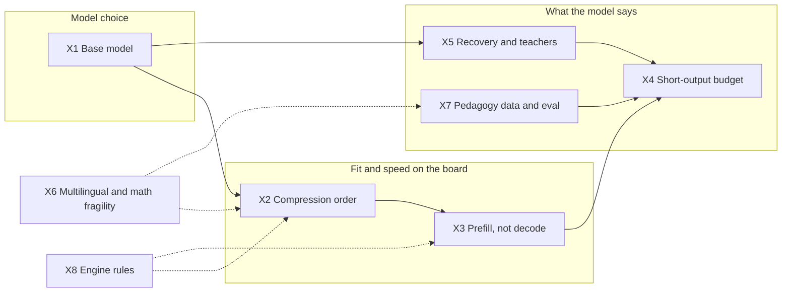

# Cross-folder junctions

Each folder has a synthesis note organised by junction: a point where two or more papers
must be read together to make one decision for the UNO Q math tutor (Gemma 3 270M/1B class,
llama.cpp/GGUF, 4× Cortex-A53, 2–4 GB RAM, CPU only). This note covers the junctions that
cross folders. It summarises no paper. It points to the folder notes, which own the evidence.

| Folder | Note | Papers | Junctions |
|---|---|---|---|
| pruning | [[pruning/_synthesis\|Pruning synthesis]] | 17 | J1–J7 |
| quantization | [[quantization/_synthesis\|Quantization synthesis]] | 22 | J1–J7 |
| inference | [[inference/_synthesis\|Inference synthesis]] | 18 | J1–J6 |
| finetuning_distillation | [[finetuning_distillation/_synthesis\|Fine-tuning synthesis]] | 7 | J1–J4 |
| surveys | [[surveys/_synthesis\|Surveys synthesis]] | 6 | J1–J3 |
| benchmarks | [[benchmarks/_synthesis\|Benchmarks synthesis]] | 2 | J1–J4 |
| tutoring_pedagogy | [[tutoring_pedagogy/_synthesis\|Tutoring synthesis]] | 5 | J1–J4 |
| jev | [[jev/_synthesis\|Jev synthesis]] | 18 | J1–J5 |

The `jev/` folder (decision models that read option probabilities instead of generating text)
was added in a separate pass. It is linked below where it touches a junction, but its evidence
was not cross-checked for this note.

In the rest of this note, "pruning J6" means junction J6 of the pruning note, and so on.

## Map

Solid arrows: the earlier decision constrains the later one. Dashed arrows: a check that runs
across every step.

## X1: Base model

**Folders.** surveys J2, benchmarks J3, inference J6, pruning J6, quantization J6.

- Surveys J2 puts Gemma 3 1B first: official int4 QAT checkpoint, small KV cache, better English
  math. Salamandra 2B oversamples Catalan and Spanish, but its own tables show weak math, and it
  has a large KV cache. It fits a laptop-side role (data, translation, judge).
- Benchmarks J3: in M3Kang, Gemma 3 1B scores below the 20% chance level, and the authors blame
  output format, not reasoning. So no paper has tested what a format-fixed Gemma 3 1B can do on Kangaroo.
- Inference J6 and pruning J6: most of Gemma 3 270M's parameters are embeddings (about 170M of
  270M). That makes it cheap in prefill and a candidate for vocabulary trimming.
- Quantization J6: BitNet b1.58 2B4T has better GSM8K than Gemma 3 1B, but it is English-centric
  and needs a different engine (inference J5). It is an alternative base, not a compression step.

**Decision.** Fine-tune Gemma 3 1B (and 270M as the fast variant). Pick between them with our own
Catalan/Spanish/English eval. No paper compares the candidates on that.

## X2: Compression order

**Folders.** quantization J3, J4, J5, J7; pruning J1, J5, J6; surveys J3; inference J5.

All the notes agree on this order. Each step runs only if the one before it is not enough:

1. Stock GGUF types on the pinned llama.cpp: Q8_0, Gemma's QAT Q4_0, Q4_K_M with a
   Catalan/Spanish/English + math importance matrix (quantization J4, J7; surveys J3).
2. Vocabulary trimming for 270M after fine-tuning (pruning J6).
3. Uniform FFN-width pruning of 1B with logit distillation from the fine-tuned 1B (pruning J3, J4).

Skip: unstructured and 2:4 sparsity (no llama.cpp gain, pruning J1), 2- and 3-bit types,
and formats llama.cpp cannot load (AQLM, QuIP#, SpQR, QuaRot; quantization J4).
Any pruned 1B must beat dense 270M on generated explanations (pruning J5).

## X3: Prefill, not decode, dominates the scored answer

**Folders.** inference J1, J2, J6; quantization J3; pruning J6.

Inference J1 reads the repo's board measurements (about 11 tok/s prefill, 6 tok/s decode, one
answer letter) as: the `predict.py` time is mostly prefill. This changes how the other folders'
speed claims apply:

- Fewer bits may not mean faster. Inference J1 found a hint that Q8_0 decoded faster than Q4_K_M
  on the board, and quantization J3 links to it. **Measure first** with `llama-bench`.
- Vocabulary trimming (pruning J6) mostly speeds up decode, through the tied output layer
  (inference J6, our inference). It helps generated hints more than the scored letter.
- Levers for prefill: shorter prompts, a fixed shared prompt prefix (inference J2, within the
  `--cache-ram 0` rule), fewer non-embedding parameters (270M vs 1B).

## X4: The short-output budget

**Folders.** benchmarks J3, finetuning_distillation J3, tutoring_pedagogy J2–J3, inference J3.

- Benchmarks J3: 60 s per problem at about 5 tok/s gives roughly 300 generated tokens. Force the
  final letter with a GBNF grammar, and report the format-failure rate as its own metric.
- Fine-tuning J3: the shortest chains of thought tested for small students (Li 2025) average about
  576 tokens, twice our budget. Our SFT data must be shorter than anything the papers tested.
- Tutoring J3: tutors do better with the reference solution, and the copilot has none. This
  points to "solve first, then tutor", which costs more tokens.
- Inference J3: speculative decoding could stretch the budget for hints only, and only if a
  `llama-bench` test shows that batch verification is cheap on the A53.

- Jev J1–J3: reading the A–E letter logits after one prefill removes the format failure and
  needs no decode for the scored answer, but calculation-heavy items need a reasoning pass first.
  Its confidence-based escalation fits a "letter first, reason only when unsure" cascade.

**Open.** Whether a 1B model can solve and explain within about 300 tokens. No paper answers it.

## X5: Recovery and teachers

**Folders.** pruning J3, J4; finetuning_distillation J1, J2, J4; quantization J5; surveys J3.

- Logit distillation needs a teacher with the same vocabulary (fine-tuning J1). That rules out
  Salamandra as a logit teacher, and it is also the recovery method Minitron uses after pruning
  (pruning J3).
- Teacher size conflicts: MiniLLM favours bigger teachers, Li 2025 favours smaller ones for
  students ≤1.5B (fine-tuning J4). Default: the smallest Gemma 3 that solves the problem.
- LoRA on all linear layers, merged into BF16 before GGUF export, is the main fine-tuning recipe
  (fine-tuning J2). The same LoRA recovery appears after pruning (pruning J3) and after layer
  dropping with QLoRA (pruning J4).
- QAT: start from Gemma's QAT checkpoint; a QAT checkpoint is tied to one target format
  (quantization J5; surveys J3). Fine-tuning on top of it is an open question (see below).

## X6: Multilingual and math fragility

**Folders.** quantization J3, J7; pruning J5; benchmarks J2, J4; surveys J1, J2; tutoring_pedagogy J1.

The same warning comes from four folders: compression damages math and lower-resource languages
first, and automatic metrics hide it.

- Quantization J7: math degrades fastest under quantization (Marchisio); multilingual calibration
  beats English-only (Chimoto). That gives the recipe for the `llama-imatrix` text.
- Pruning J5: knowledge and reasoning break at sparsity levels where perplexity looks fine
  (LLM-KICK); small models and long generation break first.
- Benchmarks J2: compare languages only on the same problem IDs; Spanish in M3Kang is a two-hop
  translation.
- Surveys J1: no survey covers multilingual effects of compression. Tutoring J1: no tutoring
  corpus exists in Catalan or Spanish.

**Decision.** After every compression step, re-run the benchmark slices (benchmarks J4):
`text_only` × level × language on shared IDs, topic, format-failure rate.

## X7: Pedagogy data and evaluation

**Folders.** tutoring_pedagogy J1, J2, J4; finetuning_distillation J3; benchmarks J1, J4.

- Data: MathDial and Bridge (English), SocraticMATH (Chinese), with unclear licences
  (tutoring J1). Synthetic data matters more than size for small math models (fine-tuning J3,
  TinyGSM). The likely path: teacher-written short Socratic explanations in ca/es/en.
- Eval protocol: copy M3Kang's (CoT prompt, last-match parsing, "N" on failure), and split train
  and val by problem ID, not by row (benchmarks J1).
- Tutor metrics: solution-leak rate scored by an LLM judge, held-out Kangaroo accuracy before and
  after SFT, and words and seconds per turn on the board (tutoring J4). SFT can hurt reasoning
  (tutoring J2), so accuracy is a regression check too.

## X8: Engine rules

**Folders.** inference J2, J5; quantization J4.

Several promising methods mean leaving the pinned llama.cpp commit `2cbe0ec` (T-MAC, bitnet.cpp,
PowerInfer; inference J5) or changing a service flag that the `unoq-board` skill fixes
(`--parallel 1 --cache-ram 0`; inference J2). **Ask the organisers** whether a forked engine
is allowed before spending time on these.

## What to read first for each decision

| Decision | Read first | Then |
|---|---|---|
| Which base model | surveys J2 | benchmarks J3, inference J6 |
| Which GGUF type | quantization J3, J4 | inference J1, quantization J7 |
| Calibration text for `llama-imatrix` | quantization J7 | benchmarks J2 |
| Whether to prune | pruning J1, J5 | pruning J6 (270M), J3–J4 (1B) |
| SFT recipe on the RTX 4060 | finetuning_distillation J2 | finetuning_distillation J1, J4 |
| SFT data and length | finetuning_distillation J3 | tutoring_pedagogy J1–J3 |
| Prompt layout and speed | inference J1, J2 | benchmarks J3 |
| Letter readout vs generated answer | jev J1, J2 | benchmarks J3, inference J1 |
| Eval harness and metrics | benchmarks J1, J4 | tutoring_pedagogy J4 |

## Open checks that cut across folders

Each note marks its own VERIFY items. These are the ones that settle a junction in another
folder too:

- `llama-bench` pp and tg on the pinned build: Q8_0 vs Q4_0 vs Q4_K_M, and 270M vs 1B
  (X2, X3; inference J1, J6; quantization J3).
- Whether a 5-token batch costs about one decode step (X4; inference J3).
- Whether Gemma 3 270M and 1B share a tokenizer, as speculative decoding and logit
  distillation both need (X4, X5; inference J3, fine-tuning J1, surveys J2).
- Gemma 3's FFN activation, which decides whether activation sparsity is closed (inference J4).
- What `llama-quantize` does with an importance matrix, and which tensor types it uses for Gemma 3's
  embeddings (X2; quantization J4).
- Whether LoRA adapters trained on the QAT checkpoint survive GGUF Q4_0 export (X5;
  fine-tuning J2, quantization J5).
- Whether the challenge scoring penalises wrong answers (benchmarks J1), and whether a forked
  engine is allowed (X8). Both are questions for the organisers.

Data: the challenge dataset is described on the
[M3Kang dataset card](https://huggingface.co/datasets/qualcomm/M3Kang). No problem text appears
in any synthesis note.
