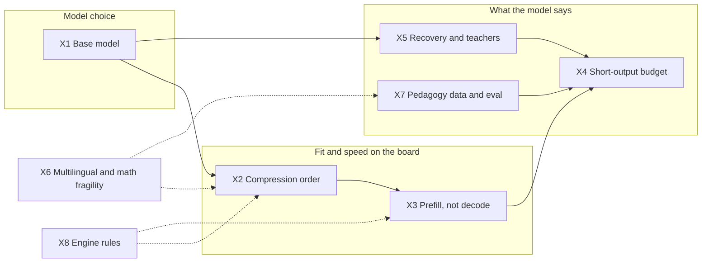

# Cross-folder junctions

This note is an explanation for team members who make a decision that needs papers from more than one folder.
To use it, find your decision in [What to read first for each decision](#what-to-read-first-for-each-decision).

Each folder has a synthesis note organized by junction.
A [junction](https://github.com/Sigkaio636/Santolina_tutor/blob/main/GLOSSARY.md) is one question that several papers answer together, to make one decision for the copilot.
This note covers the junctions that cross folders, labeled X1 to X8.
It summarizes no paper. It points to the folder notes, which own the evidence.
The acronyms PTQ, QAT, LoRA and GGUF are explained in the [Challenge context glossary](../../CHALLENGE_CONTEXT.md#10-glossary).

The target is llama.cpp/GGUF on the UNO Q: 4× Cortex-A53, 4 GB RAM, CPU only.
The deployed language model is Qwen3.5 0.8B Q8_0; the fine-tune base is not chosen yet, and this note plans on Gemma 3 270M/1B, one option being explored.

| Folder | Note | Papers | Junctions |
|---|---|---|---|
| pruning | [Pruning synthesis](pruning/_synthesis.md) | 17 | J1–J7 |
| quantization | [Quantization synthesis](quantization/_synthesis.md) | 22 | J1–J7 |
| inference | [Inference synthesis](inference/_synthesis.md) | 18 | J1–J6 |
| finetuning_distillation | [Fine-tuning synthesis](finetuning_distillation/_synthesis.md) | 7 | J1–J4 |
| surveys | [Surveys synthesis](surveys/_synthesis.md) | 6 | J1–J3 |
| benchmarks | [Benchmarks synthesis](benchmarks/_synthesis.md) | 2 | J1–J4 |
| tutoring_pedagogy | [Tutoring synthesis](tutoring_pedagogy/_synthesis.md) | 5 | J1–J4 |
| jev | [Jev synthesis](jev/_synthesis.md) | 18 | J1–J5 |

The `jev/` folder (decision models that read option probabilities instead of generating text)
was added in a separate pass. It is linked below where it touches a junction, but its evidence
was not cross-checked for this note.

In the rest of this note, "pruning J6" means junction J6 of the pruning note, and so on.

## Map of the cross-folder junctions

Solid arrows: the earlier decision constrains the later one. Dashed arrows: a check that runs
across every step.

## X1: Base model

**Folders.** [surveys J2](surveys/_synthesis.md#j2-base-model-gemma-3-vs-salamandra-2b), [benchmarks J3](benchmarks/_synthesis.md#j3-small-models-and-answer-format-failure), [inference J6](inference/_synthesis.md#j6-architecture-and-enginemodel-co-design-for-small-devices), [pruning J6](pruning/_synthesis.md#j6-vocabulary-trimming-for-gemma-3s-256k-vocabulary), [quantization J6](quantization/_synthesis.md#j6-ternary-models).

- [Surveys J2](surveys/_synthesis.md#j2-base-model-gemma-3-vs-salamandra-2b) puts Gemma 3 1B first: official int4 QAT checkpoint, small KV cache (the stored attention keys and values), better English
  math. Salamandra 2B oversamples Catalan and Spanish, but its own tables show weak math, and it
  has a large KV cache. It fits a laptop-side role (data, translation, judge).
- [Benchmarks J3](benchmarks/_synthesis.md#j3-small-models-and-answer-format-failure): in M3Kang, Gemma 3 1B scores below the 20% chance level, and the authors blame
  mainly output format. Their conclusion also names limited reasoning training. So no paper has tested what a format-fixed Gemma 3 1B can do on Kangaroo.
- [Inference J6](inference/_synthesis.md#j6-architecture-and-enginemodel-co-design-for-small-devices) and [pruning J6](pruning/_synthesis.md#j6-vocabulary-trimming-for-gemma-3s-256k-vocabulary): most of Gemma 3 270M's parameters are embeddings (about 170M of
  270M). That makes it cheap in prefill and a candidate for vocabulary trimming.
- [Quantization J6](quantization/_synthesis.md#j6-ternary-models): BitNet b1.58 2B4T scores better than Gemma 3 1B on GSM8K (grade-school math word problems), but it is English-centric
  and needs a different engine ([inference J5](inference/_synthesis.md#j5-low-bit-cpu-kernels-without-dot-product-instructions)). It is an alternative base, not a compression step.

**Decision, if the fine-tune base is Gemma 3.** Fine-tune Gemma 3 1B (and 270M as the fast variant). Pick between them with our own
Catalan/Spanish/English eval. No paper compares the candidates on that.

## X2: Compression order

**Folders.** [quantization J3](quantization/_synthesis.md#j3-do-small-models-quantize-worse), [J4](quantization/_synthesis.md#j4-low-bit-weight-only-ptq-and-what-maps-onto-gguf), [J5](quantization/_synthesis.md#j5-qat-what-this-folder-adds), [J7](quantization/_synthesis.md#j7-multilingual-and-math-damage-calibration-language); [pruning J1](pruning/_synthesis.md#j1-unstructured-and-nm-sparsity-and-the-cpu-question), [J5](pruning/_synthesis.md#j5-what-pruning-breaks), [J6](pruning/_synthesis.md#j6-vocabulary-trimming-for-gemma-3s-256k-vocabulary); [surveys J3](surveys/_synthesis.md#j3-how-much-qat-costs); [inference J5](inference/_synthesis.md#j5-low-bit-cpu-kernels-without-dot-product-instructions).

All the notes agree on this order. Each step runs only if the one before it is not enough:

1. Stock GGUF types on the pinned llama.cpp: Q8_0, Gemma's QAT Q4_0, Q4_K_M with a
   Catalan/Spanish/English + math importance matrix (`llama-imatrix`, computed from calibration text) ([quantization J4](quantization/_synthesis.md#j4-low-bit-weight-only-ptq-and-what-maps-onto-gguf), [J7](quantization/_synthesis.md#j7-multilingual-and-math-damage-calibration-language); [surveys J3](surveys/_synthesis.md#j3-how-much-qat-costs)).
2. Vocabulary trimming for 270M after fine-tuning ([pruning J6](pruning/_synthesis.md#j6-vocabulary-trimming-for-gemma-3s-256k-vocabulary)).
3. Uniform pruning of the feed-forward (FFN) layer width of 1B, with [logit distillation](https://github.com/Sigkaio636/Santolina_tutor/blob/main/GLOSSARY.md) from the fine-tuned 1B ([pruning J3](pruning/_synthesis.md#j3-structured-pruning-with-recovery-data-and-compute), [J4](pruning/_synthesis.md#j4-depth-pruning-vs-width-pruning)).

Skip: unstructured and 2:4 sparsity (2 zeros in every 4 weights; no llama.cpp gain, [pruning J1](pruning/_synthesis.md#j1-unstructured-and-nm-sparsity-and-the-cpu-question)), 2- and 3-bit types,
and formats llama.cpp cannot load (AQLM, QuIP#, SpQR, QuaRot; [quantization J4](quantization/_synthesis.md#j4-low-bit-weight-only-ptq-and-what-maps-onto-gguf)).
Any pruned 1B must beat the unpruned (dense) 270M on generated explanations ([pruning J5](pruning/_synthesis.md#j5-what-pruning-breaks)).

## X3: Prefill, not decode, dominates the scored answer

**Folders.** [inference J1](inference/_synthesis.md#j1-where-the-time-goes-prefill-vs-decode), [J2](inference/_synthesis.md#j2-kv-cache-size-reuse-eviction-quantization), [J6](inference/_synthesis.md#j6-architecture-and-enginemodel-co-design-for-small-devices); [quantization J3](quantization/_synthesis.md#j3-do-small-models-quantize-worse); [pruning J6](pruning/_synthesis.md#j6-vocabulary-trimming-for-gemma-3s-256k-vocabulary).

[Inference J1](inference/_synthesis.md#j1-where-the-time-goes-prefill-vs-decode) reads the board speeds this way: the scored answer is one letter, so most of the `predict.py` time is prefill (reading the prompt), not decode (writing the answer).
Our board measures 10.1 tok/s prefill and 4.8 tok/s decode ([board reference §14.3](../../UNO_Q_BOARD_REFERENCE.md#143-speed)).
The organizers' figures are about 11 and 6 tok/s ([BOARD_SETUP §13.1](../../BOARD_SETUP.md#131-start-from-what-the-board-can-do)).
This changes how the other folders'
speed claims apply:

- Fewer bits may not mean faster. [Inference J1](inference/_synthesis.md#j1-where-the-time-goes-prefill-vs-decode) found a hint that Q8_0 decoded faster than Q4_K_M
  on the board, and [quantization J3](quantization/_synthesis.md#j3-do-small-models-quantize-worse) links to it. **Measure first** with `llama-bench`.
- Vocabulary trimming ([pruning J6](pruning/_synthesis.md#j6-vocabulary-trimming-for-gemma-3s-256k-vocabulary)) mostly speeds up decode, through the tied output layer.
  A tied output layer shares its weights with the embedding table.
  This is our deduction from [inference J6](inference/_synthesis.md#j6-architecture-and-enginemodel-co-design-for-small-devices), not a paper's result.
  It helps generated hints more than the scored letter.
- Levers for prefill: shorter prompts, a fixed shared prompt prefix ([inference J2](inference/_synthesis.md#j2-kv-cache-size-reuse-eviction-quantization)), fewer non-embedding parameters (270M vs 1B).
  The services run with `--cache-ram 0`, which keeps no prompt cache in RAM.
  Whether `cache_prompt` still reuses the shared prefix is not measured on our board (see [Open questions](#open-questions)).

## X4: The short-output budget

**Folders.** [benchmarks J3](benchmarks/_synthesis.md#j3-small-models-and-answer-format-failure), [finetuning_distillation J3](finetuning_distillation/_synthesis.md#j3-training-data-for-small-model-math-reasoning), [tutoring_pedagogy J2–J3](tutoring_pedagogy/_synthesis.md#j2-inducing-pedagogical-behaviour-prompting-vs-sft-vs-rl), [inference J3](inference/_synthesis.md#j3-speculative-decoding-on-a-cpu).

- [Benchmarks J3](benchmarks/_synthesis.md#j3-small-models-and-answer-format-failure): the limit is 60 s per problem, and prefill uses part of it.
  A short problem leaves room for about 150–250 reasoning tokens ([jev J2](jev/_synthesis.md#j2-calculation-heavy-items-and-the-value-of-reasoning)).
  Our copilot already forces the final letter with a llama.cpp (GBNF) grammar, `root ::= [A-E]` in [`copilot/llm.py`](https://github.com/Sigkaio636/Santolina_tutor/blob/main/copilot/llm.py).
  Report the format-failure rate as its own metric.
- [Fine-tuning J3](finetuning_distillation/_synthesis.md#j3-training-data-for-small-model-math-reasoning): the shortest chains of thought tested for small student models (Li 2025) average about
  576 tokens, far over our budget. Our supervised fine-tuning (SFT) data must be shorter than anything the papers tested.
- [Tutoring J3](tutoring_pedagogy/_synthesis.md#j3-grounding-what-the-tutor-sees): tutors do better with the reference solution, and the copilot has none. This
  points to "solve first, then tutor", which costs more tokens.
- [Inference J3](inference/_synthesis.md#j3-speculative-decoding-on-a-cpu): speculative decoding could stretch the budget for hints only, and only if a
  `llama-bench` test shows that checking a batch of draft tokens in one pass is cheap on the A53.

- [Jev J1–J3](jev/_synthesis.md#j1-letter-logit-scoring-vs-generating-the-answer): reading the scores (logits) of the letters A–E after one prefill removes the format failure and
  needs no decode for the scored answer, but calculation-heavy items need a reasoning pass first.
  Its confidence-based escalation fits a "letter first, reason only when unsure" cascade.

**Open.** Whether a 1B model can solve and explain within that budget. No paper answers it.

## X5: Recovery and teachers

**Folders.** [pruning J3](pruning/_synthesis.md#j3-structured-pruning-with-recovery-data-and-compute), [J4](pruning/_synthesis.md#j4-depth-pruning-vs-width-pruning); [finetuning_distillation J1](finetuning_distillation/_synthesis.md#j1-distillation-objective-soft-targets-text-or-reverse-kl), [J2](finetuning_distillation/_synthesis.md#j2-parameter-efficient-fine-tuning-on-a-laptop-gpu), [J4](finetuning_distillation/_synthesis.md#j4-teacher-size-and-the-capacity-gap); [quantization J5](quantization/_synthesis.md#j5-qat-what-this-folder-adds); [surveys J3](surveys/_synthesis.md#j3-how-much-qat-costs).

- Logit distillation needs a teacher with the same vocabulary ([fine-tuning J1](finetuning_distillation/_synthesis.md#j1-distillation-objective-soft-targets-text-or-reverse-kl)). That rules out
  Salamandra as a logit teacher. Logit distillation is also the recovery method Minitron uses after pruning
  ([pruning J3](pruning/_synthesis.md#j3-structured-pruning-with-recovery-data-and-compute)).
- Teacher size conflicts: MiniLLM favors bigger teachers, Li 2025 favors smaller ones for
  student models ≤1.5B ([fine-tuning J4](finetuning_distillation/_synthesis.md#j4-teacher-size-and-the-capacity-gap)). Default: the smallest Gemma 3 that solves the problem.
- LoRA on all linear layers, merged into BF16 before GGUF export, is the main fine-tuning recipe
  ([fine-tuning J2](finetuning_distillation/_synthesis.md#j2-parameter-efficient-fine-tuning-on-a-laptop-gpu)). The same LoRA recovery appears after pruning ([pruning J3](pruning/_synthesis.md#j3-structured-pruning-with-recovery-data-and-compute)) and after layer
  dropping with QLoRA ([pruning J4](pruning/_synthesis.md#j4-depth-pruning-vs-width-pruning)).
- QAT: start from Gemma's QAT checkpoint; a QAT checkpoint is tied to one target format
  ([quantization J5](quantization/_synthesis.md#j5-qat-what-this-folder-adds); [surveys J3](surveys/_synthesis.md#j3-how-much-qat-costs)). Fine-tuning on top of it is an open question (see [Open questions](#open-questions)).

## X6: Multilingual and math fragility

**Folders.** [quantization J3](quantization/_synthesis.md#j3-do-small-models-quantize-worse), [J7](quantization/_synthesis.md#j7-multilingual-and-math-damage-calibration-language); [pruning J5](pruning/_synthesis.md#j5-what-pruning-breaks); [benchmarks J2](benchmarks/_synthesis.md#j2-language-effects-catalan-spanish-english), [J4](benchmarks/_synthesis.md#j4-modality-level-and-topic-confounds-which-slices-to-report); [surveys J1](surveys/_synthesis.md#j1-survey-crosswalk-to-the-vault), [J2](surveys/_synthesis.md#j2-base-model-gemma-3-vs-salamandra-2b); [tutoring_pedagogy J1](tutoring_pedagogy/_synthesis.md#j1-tutoring-datasets-and-their-formats).

The same warning comes from four folders: compression damages math and lower-resource languages
first, and automatic metrics hide it.

- [Quantization J7](quantization/_synthesis.md#j7-multilingual-and-math-damage-calibration-language): math degrades fastest under quantization (Marchisio); multilingual calibration
  beats English-only (Chimoto). That gives the recipe for the `llama-imatrix` text.
- [Pruning J5](pruning/_synthesis.md#j5-what-pruning-breaks): knowledge and reasoning break at sparsity levels where perplexity looks fine
  (LLM-KICK); small models and long generation break first.
- [Benchmarks J2](benchmarks/_synthesis.md#j2-language-effects-catalan-spanish-english): compare languages only on the same problem IDs; Spanish in M3Kang is a two-hop
  translation.
- [Surveys J1](surveys/_synthesis.md#j1-survey-crosswalk-to-the-vault): no survey covers multilingual effects of compression. [Tutoring J1](tutoring_pedagogy/_synthesis.md#j1-tutoring-datasets-and-their-formats): no tutoring
  corpus exists in Catalan or Spanish.

**Decision.** After every compression step, re-run the benchmark slices ([benchmarks J4](benchmarks/_synthesis.md#j4-modality-level-and-topic-confounds-which-slices-to-report)):
`text_only` × level × language on shared IDs, topic, format-failure rate.

## X7: Pedagogy data and evaluation

**Folders.** [tutoring_pedagogy J1](tutoring_pedagogy/_synthesis.md#j1-tutoring-datasets-and-their-formats), [J2](tutoring_pedagogy/_synthesis.md#j2-inducing-pedagogical-behaviour-prompting-vs-sft-vs-rl), [J4](tutoring_pedagogy/_synthesis.md#j4-evaluating-a-tutor); [finetuning_distillation J3](finetuning_distillation/_synthesis.md#j3-training-data-for-small-model-math-reasoning); [benchmarks J1](benchmarks/_synthesis.md#j1-two-kangaroo-benchmarks-side-by-side), [J4](benchmarks/_synthesis.md#j4-modality-level-and-topic-confounds-which-slices-to-report).

- Data: MathDial and Bridge (English), SocraticMATH (Chinese), with unclear licenses
  ([tutoring J1](tutoring_pedagogy/_synthesis.md#j1-tutoring-datasets-and-their-formats)). Synthetic data matters more than size for small math models ([fine-tuning J3](finetuning_distillation/_synthesis.md#j3-training-data-for-small-model-math-reasoning),
  TinyGSM). The likely path: teacher-written short Socratic explanations in ca/es/en.
- Eval protocol: copy M3Kang's (chain-of-thought (CoT) prompt, last-match parsing, "N" when no answer is found), and split the training
  and validation sets by problem ID, not by row ([benchmarks J1](benchmarks/_synthesis.md#j1-two-kangaroo-benchmarks-side-by-side)).
- Copilot metrics: solution-leak rate scored by an LLM judge, Kangaroo accuracy on the validation set before and
  after SFT, and words and seconds per turn on the board ([tutoring J4](tutoring_pedagogy/_synthesis.md#j4-evaluating-a-tutor)). SFT can hurt reasoning
  ([tutoring J2](tutoring_pedagogy/_synthesis.md#j2-inducing-pedagogical-behaviour-prompting-vs-sft-vs-rl)), so accuracy is a regression check too.

## X8: Engine rules

**Folders.** [inference J2](inference/_synthesis.md#j2-kv-cache-size-reuse-eviction-quantization), [J5](inference/_synthesis.md#j5-low-bit-cpu-kernels-without-dot-product-instructions); [quantization J4](quantization/_synthesis.md#j4-low-bit-weight-only-ptq-and-what-maps-onto-gguf).

Several promising methods need an engine other than the pinned llama.cpp commit `2cbe0ec`:
T-MAC, bitnet.cpp and PowerInfer ([inference J5](inference/_synthesis.md#j5-low-bit-cpu-kernels-without-dot-product-instructions)).
Others need a change to a service flag that the [`unoq-board` skill](https://github.com/Sigkaio636/Santolina_tutor/tree/main/.claude/skills/unoq-board) fixes:
`--parallel 1 --cache-ram 0` ([inference J2](inference/_synthesis.md#j2-kv-cache-size-reuse-eviction-quantization)). **Ask the organizers** whether a forked engine
is allowed before spending time on these.

## What to read first for each decision

| Decision | Read first | Then |
|---|---|---|
| Which base model | [surveys J2](surveys/_synthesis.md#j2-base-model-gemma-3-vs-salamandra-2b) | [benchmarks J3](benchmarks/_synthesis.md#j3-small-models-and-answer-format-failure), [inference J6](inference/_synthesis.md#j6-architecture-and-enginemodel-co-design-for-small-devices) |
| Which GGUF type | [quantization J3](quantization/_synthesis.md#j3-do-small-models-quantize-worse), [J4](quantization/_synthesis.md#j4-low-bit-weight-only-ptq-and-what-maps-onto-gguf) | [inference J1](inference/_synthesis.md#j1-where-the-time-goes-prefill-vs-decode), [quantization J7](quantization/_synthesis.md#j7-multilingual-and-math-damage-calibration-language) |
| Calibration text for `llama-imatrix` | [quantization J7](quantization/_synthesis.md#j7-multilingual-and-math-damage-calibration-language) | [benchmarks J2](benchmarks/_synthesis.md#j2-language-effects-catalan-spanish-english) |
| Whether to prune | [pruning J1](pruning/_synthesis.md#j1-unstructured-and-nm-sparsity-and-the-cpu-question), [J5](pruning/_synthesis.md#j5-what-pruning-breaks) | [pruning J6](pruning/_synthesis.md#j6-vocabulary-trimming-for-gemma-3s-256k-vocabulary) (270M), [J3–J4](pruning/_synthesis.md#j3-structured-pruning-with-recovery-data-and-compute) (1B) |
| SFT recipe on our 8 GB RTX 4060 training GPU | [finetuning_distillation J2](finetuning_distillation/_synthesis.md#j2-parameter-efficient-fine-tuning-on-a-laptop-gpu) | [finetuning_distillation J1](finetuning_distillation/_synthesis.md#j1-distillation-objective-soft-targets-text-or-reverse-kl), [J4](finetuning_distillation/_synthesis.md#j4-teacher-size-and-the-capacity-gap) |
| SFT data and length | [finetuning_distillation J3](finetuning_distillation/_synthesis.md#j3-training-data-for-small-model-math-reasoning) | [tutoring_pedagogy J1–J3](tutoring_pedagogy/_synthesis.md#j1-tutoring-datasets-and-their-formats) |
| Prompt layout and speed | [inference J1](inference/_synthesis.md#j1-where-the-time-goes-prefill-vs-decode), [J2](inference/_synthesis.md#j2-kv-cache-size-reuse-eviction-quantization) | [benchmarks J3](benchmarks/_synthesis.md#j3-small-models-and-answer-format-failure) |
| Letter readout vs generated answer | [jev J1](jev/_synthesis.md#j1-letter-logit-scoring-vs-generating-the-answer), [J2](jev/_synthesis.md#j2-calculation-heavy-items-and-the-value-of-reasoning) | [benchmarks J3](benchmarks/_synthesis.md#j3-small-models-and-answer-format-failure), [inference J1](inference/_synthesis.md#j1-where-the-time-goes-prefill-vs-decode) |
| Eval harness and metrics | [benchmarks J1](benchmarks/_synthesis.md#j1-two-kangaroo-benchmarks-side-by-side), [J4](benchmarks/_synthesis.md#j4-modality-level-and-topic-confounds-which-slices-to-report) | [tutoring_pedagogy J4](tutoring_pedagogy/_synthesis.md#j4-evaluating-a-tutor) |

## Open questions

Each note lists its own open checks. These are the ones that settle a junction in another
folder too:

- `llama-bench` prefill (pp) and decode (tg) speed on the pinned build: Q8_0 vs Q4_0 vs Q4_K_M, and 270M vs 1B
  (X2, X3; [inference J1](inference/_synthesis.md#j1-where-the-time-goes-prefill-vs-decode), [J6](inference/_synthesis.md#j6-architecture-and-enginemodel-co-design-for-small-devices); [quantization J3](quantization/_synthesis.md#j3-do-small-models-quantize-worse)).
- Whether a 5-token batch costs about one decode step (X4; [inference J3](inference/_synthesis.md#j3-speculative-decoding-on-a-cpu)).
- Whether Gemma 3 270M and 1B share a tokenizer, as speculative decoding and logit
  distillation both need (X4, X5; [inference J3](inference/_synthesis.md#j3-speculative-decoding-on-a-cpu), [fine-tuning J1](finetuning_distillation/_synthesis.md#j1-distillation-objective-soft-targets-text-or-reverse-kl), [surveys J2](surveys/_synthesis.md#j2-base-model-gemma-3-vs-salamandra-2b)).
- Gemma 3's FFN activation, which decides whether activation sparsity is closed ([inference J4](inference/_synthesis.md#j4-activation-sparsity-and-offloading)).
- What `llama-quantize` does with an importance matrix, and which tensor types it uses for Gemma 3's
  embeddings (X2; [quantization J4](quantization/_synthesis.md#j4-low-bit-weight-only-ptq-and-what-maps-onto-gguf)).
- Whether LoRA adapters trained on the QAT checkpoint survive GGUF Q4_0 export (X5;
  [fine-tuning J2](finetuning_distillation/_synthesis.md#j2-parameter-efficient-fine-tuning-on-a-laptop-gpu), [quantization J5](quantization/_synthesis.md#j5-qat-what-this-folder-adds)).
- Whether `cache_prompt` reuses a fixed shared prompt prefix while the services run with `--cache-ram 0`.
  Not measured on our board (X3; [inference J2](inference/_synthesis.md#j2-kv-cache-size-reuse-eviction-quantization)).
- Whether the challenge scoring penalizes wrong answers ([benchmarks J1](benchmarks/_synthesis.md#j1-two-kangaroo-benchmarks-side-by-side)), and whether a forked
  engine is allowed (X8). Both are questions for the organizers.

Data: the challenge dataset is described on the
[M3Kang dataset card](https://huggingface.co/datasets/qualcomm/M3Kang). No problem text appears
in any synthesis note.
